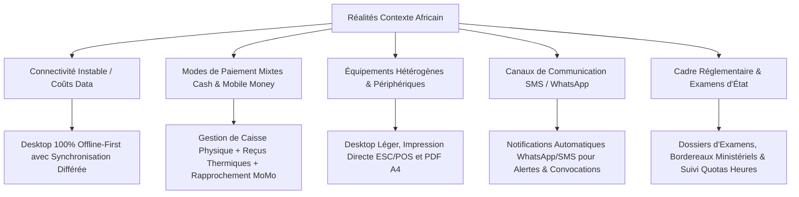
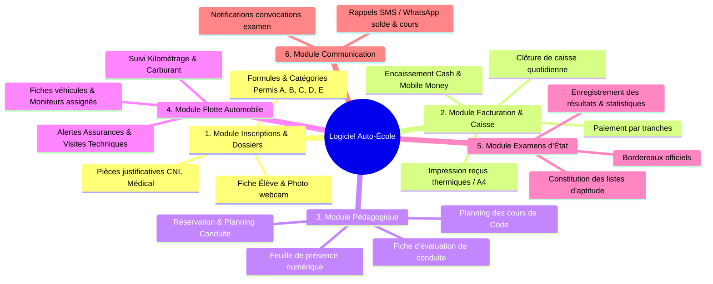
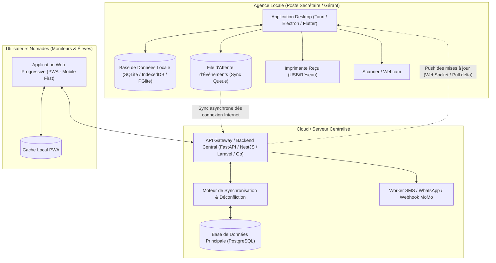
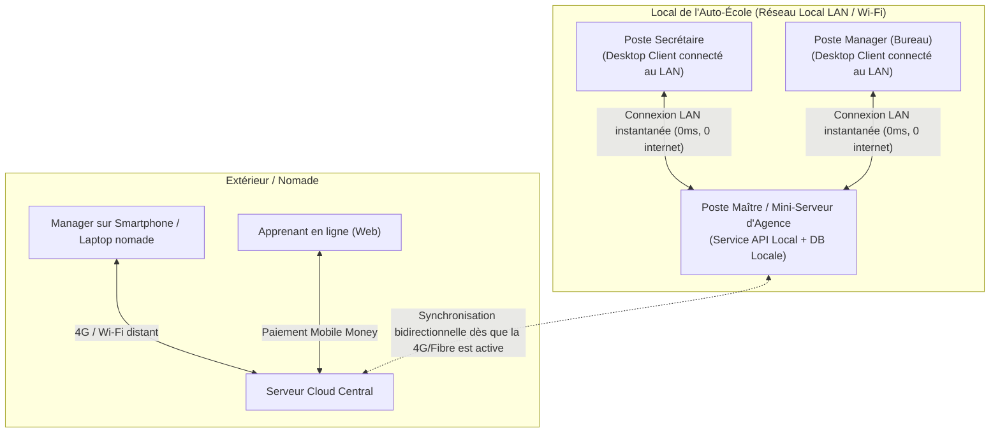
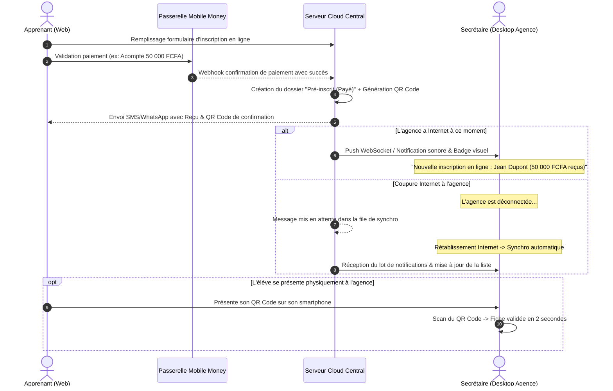
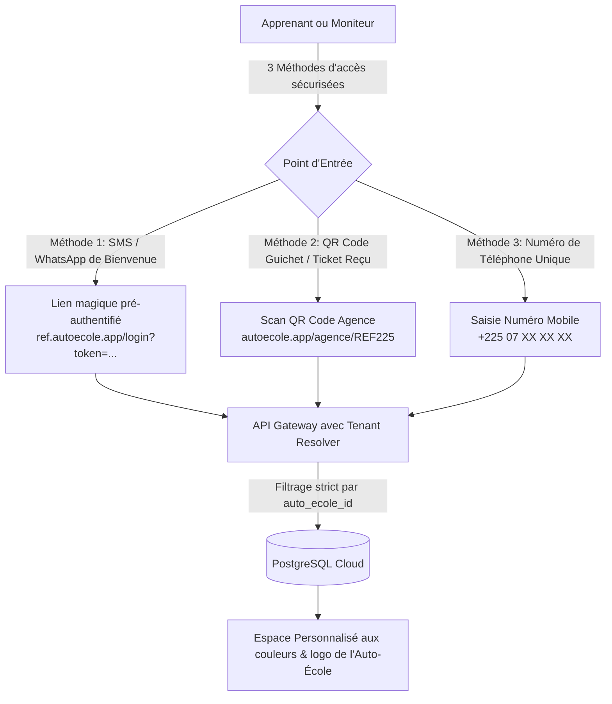
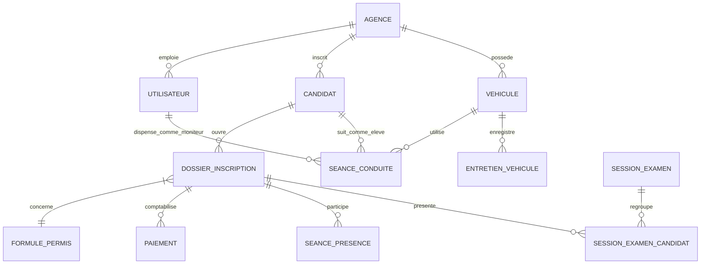
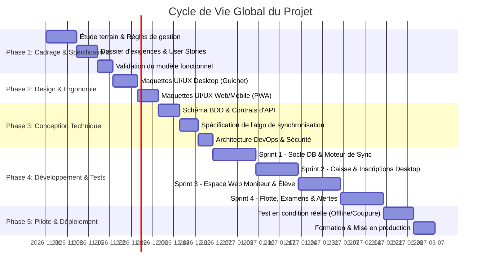

# Dossier de Cadrage Stratégique, Architecture & Cycle de Vie
## Logiciel Hybride de Gestion d'Auto-École (Contexte Africain)

---

## 1. Analyse des Spécificités & Défis du Contexte Africain

Pour concevoir une solution robuste, viable et adoptée facilement, le logiciel doit être pensé dès la première ligne de conception autour des réalités du terrain africain :

### 1.1. Les Enjeux Clés
1. **Connectivité intermittente (Offline-First impératif)** :
   - L'agence (secrétariat, comptabilité) ne peut pas se permettre d'être bloquée lors d'une coupure Internet ou électrique.
   - Les encaissements, inscriptions et plannings doivent continuer à fonctionner en local.
2. **Économie mixte (Cash + Mobile Money + Facilités de paiement)** :
   - Rares sont les élèves qui paient la totalité en une fois par carte bancaire. Les paiements se font par tranches (acomptes), souvent en espèces au guichet ou via Mobile Money (Orange Money, MTN MoMo, Wave, Moov, Airtel).
   - Nécessité absolue de tickets de caisse infalsifiables et de clôtures de caisse journalières.
3. **Flotte automobile et contraintes matérielles** :
   - Suivi strict de l'état des véhicules école : kilométrage, vidanges, visites techniques, assurances, consommations de carburant.
4. **Relations avec l'Administration / Ministère des Transports** :
   - Constitution des dossiers d'examen, quotas d'heures théoriques et pratiques obligatoires, bordereaux de passage aux examens officiels.
5. **Communication mobile directe** :
   - L'email est très peu consulté par les apprenants. WhatsApp et les SMS transactionnels sont les canaux d'interaction indispensables.

---

## 2. Cartographie des Acteurs & Répartition Hybride

Le choix d'une architecture hybride sépare les usages intensifs et administratifs (Desktop) des usages mobiles et décentralisés (Web/Mobile).

| Acteur | Interface Principale | Matériel Ciblé | Rôle & Besoins Clés |
| :--- | :--- | :--- | :--- |
| **Promoteur / Directeur** | Desktop & Web Mobile | PC Bureau / Ordinateur portable / Smartphone | Pilotage financier, validation des remises, statistiques globales, audit de caisse, suivi des taux de réussite. |
| **Secrétaire / Caissier(ère)** | **Desktop Local** (Offline-first) | PC Bureau Windows, Imprimante ticket / A4, Webcam/Scanner | Enrôlement des élèves, saisie des acomptes, délivrance de reçus physiques, pointage des présences en salle de code. |
| **Moniteur (Enseignant)** | **Web / PWA Mobile** | Smartphone Android / iOS | Consultation du planning journalier, validation des heures effectuées, notation de la progression de l'élève (fiche de suivi numérique). |
| **Apprenant (Candidat)** | **Web / PWA Mobile** | Smartphone | Consultation du solde financier, planning des séances, quiz d'entraînement au code de la route, convocations aux examens. |
| **Super-Administrateur** | Web Console Centrale | PC / Cloud | Paramétrage multi-agences, gestion des licences, supervision de la synchronisation, sauvegardes. |

---

## 3. Découpage Modulaire Fonctionnel

---

## 4. Architecture Système Hybride & Stratégie de Données

### 4.1. Vue d'Ensemble de l'Architecture

### 4.2. Topologie Réseau en Agence (Manager & Secrétaire sur la même base)

Comment la secrétaire et le manager collaborent-ils sans se marcher dessus, même en cas de coupure Internet ?

1. **Au sein de l'agence (Réseau Local sans Internet)** :
   - Un des ordinateurs (souvent le PC fixe du manager ou un petit boîtier PC dédié de bureau) joue le rôle de **Poste Maître (Serveur d'Agence)**. Il héberge le moteur local et la base de données.
   - Le poste de la secrétaire se connecte directement au Poste Maître via le câble réseau (Ethernet) ou le routeur Wi-Fi de l'auto-école.
   - **Bénéfice immédiat** : Même si la connexion Internet est totalement coupée, le manager et la secrétaire travaillent en simultané sur la **même base locale en temps réel**, sans aucun délai ni conflit.
2. **Lorsque le Manager est en déplacement** :
   - Le manager consulte l'application mobile ou web reliée au Cloud central.
   - Dès que le Poste Maître de l'agence a du réseau, il réplique les données vers le Cloud, permettant au gérant de suivre la caisse et les inscriptions depuis son téléphone partout dans le monde.

---

### 4.3. Flux d'une Inscription & Paiement en Ligne (Web vers Desktop Secrétaire)

Lorsqu'un apprenant s'inscrit sur le portail Web et effectue son règlement (ex: via Wave ou Orange Money), voici le mécanisme de notification et de prise en charge :

#### Ce que voit concrètement la secrétaire :
1. **Notification Instantanée (Mode Connecté)** :
   - Une alerte visuelle (bannière discrète avec sonnette) apparaît en haut de son écran Desktop :  
     `"🔔 Nouvelle inscription en ligne : Amadou K. - Formule Permis B - Acompte de 60 000 FCFA validé via Wave"`.
   - L'onglet **"Inscriptions Web à traiter"** affiche un badge rouge d'incrémentation (ex: `[3]`).
2. **En cas de Coupure Internet au moment du paiement** :
   - L'élève reçoit immédiatement son reçu officiel par **SMS et WhatsApp** directement depuis le Cloud, avec un numéro de dossier unique et un **QR Code de retrait**.
   - Dès que le poste de la secrétaire retrouve la connexion (même quelques heures plus tard), le synchroniseur télécharge automatiquement les nouveaux dossiers.
   - Si l'élève arrive à l'agence avant le retour d'Internet, la secrétaire saisit le numéro de transaction ou scanne le QR code du reçu de l'élève : le système enregistre la confirmation locale provisoire.

### 4.4. Isolation Multi-Agences & Connexion sans Confusion (Multi-Tenancy)

Comment s'assurer qu'un apprenant ou un moniteur se connecte rigoureusement à son auto-école sans risque de confusion avec une autre agence concurrente ou une succursale ?

#### 1. Pour l'Apprenant (Zéro friction, zéro erreur)
- **Le Lien Magique par WhatsApp / SMS** : Dès son inscription au guichet ou en ligne, l'apprenant reçoit un message :  
  *« Bienvenue chez Auto-École La Référence ! Accédez à vos cours et planning ici : `https://ref.autoecole.app` »*. En cliquant, son application web s'ouvre directement avec le logo, le nom et le contact de son agence.
- **Résolution par le Numéro de Téléphone** : Si l'élève tape simplement son numéro sur le portail global, le système recherche immédiatement son dossier unique et le connecte directement à son école.
- **QR Code sur le reçu de caisse** : Le ticket de caisse imprimé au guichet comporte un QR Code : *"Scannez pour suivre vos cours et votre solde"*.

#### 2. Pour le Moniteur (Affiliation stricte)
- Le moniteur est créé par le Manager sur le logiciel Desktop.
- Son compte est verrouillé avec son numéro de téléphone et son identifiant d'agence (`auto_ecole_id`).
- Lorsqu'il ouvre son application web, il ne voit **que** les véhicules et les élèves de son agence de rattachement. S'il intervient sur 2 succursales du même réseau, un sélecteur d'agence lui permet de basculer en 1 clic.

#### 3. Au niveau de la Base de Données (Sécurité & Cloisonnement)
- **Règle absolue** : Chaque table (`candidats`, `seances`, `paiements`, `vehicules`) possède une colonne obligatoire `auto_ecole_id` et `agence_id`.
- **Politique Row-Level Security (RLS)** : Même en cas de bug dans le code d'affichage, la base de données PostgreSQL refuse mathématiquement de renvoyer les données d'une auto-école B à un utilisateur de l'auto-école A.

---

### 4.5. Stratégie de Résilience & Synchronisation (Offline-First)

Pour garantir que l'application de bureau reste opérationnelle sans Internet tout en maintenant la cohérence globale :

1. **Architecture Event-Driven Locale (File d'attente d'actions)** :
   - Chaque action locale (ex: `ENCAISSER_TRANCHE`, `INSCRIRE_ELEVE`) est enregistrée dans une table locale `sync_events` avec un identifiant unique (UUID v4) et un horodatage UTC.
   - L'interface locale se met à jour immédiatement (latence zéro).
2. **Synchronisation Incrémentale Bidirectionnelle (Sync Engine)** :
   - Un processus d'arrière-plan surveille la connectivité Internet.
   - Dès que le réseau est disponible, les événements en attente sont envoyés par paquets (`batch`) au serveur central.
   - Le serveur central valide, applique les mutations, et renvoie un accusé de réception ainsi que les deltas (modifications survenues côté web/moniteurs).
3. **Résolution des Conflits Métier** :
   - **Règle financière** : Les écritures de caisse sont immutables et uniquement en ajout (Append-Only) ; aucun risque d'écrasement.
   - **Règle de planning** : Priorité au premier événement validé par le serveur central, avec notification visuelle sur le Desktop en cas de double réservation d'un créneau de conduite.

---

## 5. Modélisation Conceptuelle des Données (Entités Principales)

### Dictionnaire des Entités Clés
- **Candidat / Élève** : Données d'état civil, photos, coordonnées, contact tuteur/parent, groupe sanguin, statut médical.
- **Dossier d'Inscription** : Date d'inscription, formule (Permis A, B, C, D, perfectionnement), montant total convenu, statut (en cours, ajourné, certifié).
- **Paiement / Transaction** : Identifiant de reçu, référence caisse, mode de règlement (Espèces, Orange Money, Wave, MTN MoMo, Virement), date/heure, caissier responsable, solde restant calculé.
- **Séance (Théorie & Pratique)** : Date, heure début/fin, véhicule, moniteur, compétences travaillées (selon le livret d'apprentissage officiel), signature/validation du moniteur.
- **Véhicule** : Immatriculation, modèle, date d'expiration de l'assurance, visite technique, vidange programmée, relevé kilométrique journalier.
- **Session d'Examen** : Date, centre d'examen officiel, inspecteur/examinateur, bordereau, liste des candidats convoqués, résultats (Code réussi / Conduite réussie).

---

## 6. Cycle de Vie Logiciel (SDLC) & Méthodologie Préconisée

Pour ce projet hybride, nous adoptons un **Cycle en V Évolutif / Agile Hybride** en 5 étapes rigoureuses :

### Détail des Étapes de Conception

#### Étape 1 : Cadrage Détaillé & Spécifications Fonctionnelles
- Validation des grilles tarifaires et règles de remises/pénalités.
- Recueil des modèles de documents légaux locaux (modèles de bordereaux d'examen de la région/pays cible : Côte d'Ivoire, Sénégal, Cameroun, etc.).
- Définition exacte des droits d'accès selon les profils utilisateurs.

#### Étape 2 : Design UX/UI & Ergonomie Spécialisée
- **Desktop (Interface Caissier/Secrétaire)** : Interface à fort rendement, raccourcis clavier, saisie rapide sans souris pour les encaissements, prévisualisation immédiate et impression 1-clic de tickets de caisse.
- **Web/Mobile (Moniteur & Élève)** : Interface ultra-légère (faible consommation de données), boutons larges utilisables d'une seule main en voiture pour le moniteur, support du mode sombre pour l'extérieur.

#### Étape 3 : Spécification Technique & Contrats d'Interface
- Définition formelle des contrats d'API (OpenAPI / Swagger).
- Modélisation du protocole de synchronisation (gestion des réémissions en cas de coupure de réseau au milieu d'un envoi).
- Politique de sécurité : chiffrement de la base locale (SQLCipher / Chiffrement fichier), gestion des jetons JWT sécurisés et tokens d'API.

#### Étape 4 : Développement Itératif & Recette Continue
- Tests unitaires et d'intégration sur les calculs financiers (la caisse ne doit avoir aucune anomalie de centime ou d'arrondi).
- Simulation de pannes réseau : injection de coupures de courant et déconnexions pendant un encaissement pour valider la non-perte de données.

#### Étape 5 : Déploiement Pilote & Amélioration Continue
- Phase pilote dans 1 ou 2 auto-écoles représentatives.
- Recueil des retours secrétaires et moniteurs sur l'ergonomie.
- Déploiement généralisé avec mécanisme de mise à jour automatique discrète pour le Desktop.

---

## 7. Matrice des Risques & Stratégies de Contournement

| Risque Identifié | Impact | Probabilité | Solution Architecturale Intégrée |
| :--- | :--- | :--- | :--- |
| **Coupure réseau prolongée (plusieurs jours)** | Élevé | Très élevée | Le Desktop fonctionne en autonomie complète indéfiniment. Les données s'empilent dans la file locale et se synchronisent naturellement au rétablissement du réseau. |
| **Panne de machine / Disque dur défaillant** | Critique | Moyenne | Système de sauvegarde locale automatique quotidienne sur clé USB branchée + copie chiffrée sur le cloud dès que la connexion est rétablie. |
| **Fraude de caisse / Modification a posteriori** | Critique | Élevée | Registre comptable en journal immuable (*audit trail*). Toute annulation nécessite un avoir contresigné avec motif obligatoire et alerte au gérant. |
| **Saturation de la mémoire/data des smartphones des moniteurs** | Moyen | Élevée | Application PWA ultra-légère (pas de téléchargement lourd sur les stores), mise en cache intelligente des données strictes de la journée. |
| **Erreur de manipulation d'une imprimante ticket** | Moyen | Élevée | Possibilité de réimprimer un duplicata marqué explicitement "DUPLICATA" pour éviter l'usage de faux reçus. |

---

## 8. Prochaines Actions Immédiates (Feuille de Route de Discussion)

1. **Clarification du pays ou de la sous-région cible** : Pour adapter la terminologie (ex: catégories de permis, documents exigés par le Ministère).
2. **Choix de la pile technologique recommandée** :
   - *Desktop* : Tauri (ultra-léger, très performant, faible consommation RAM) ou Electron ou Flutter Desktop.
   - *Backend* : Go ou Node.js (NestJS) ou Python (FastAPI).
   - *Web/PWA* : Vue.js ou React avec TailwindCSS/Vanilla.
3. **Validation de la structure de caisse et des workflows d'inscription**.
