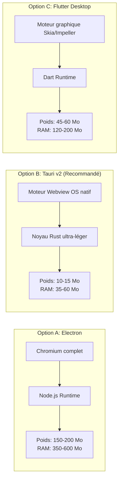
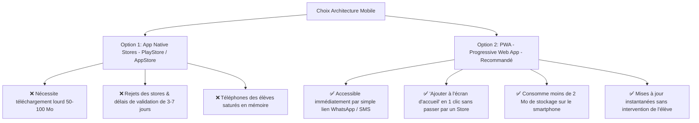
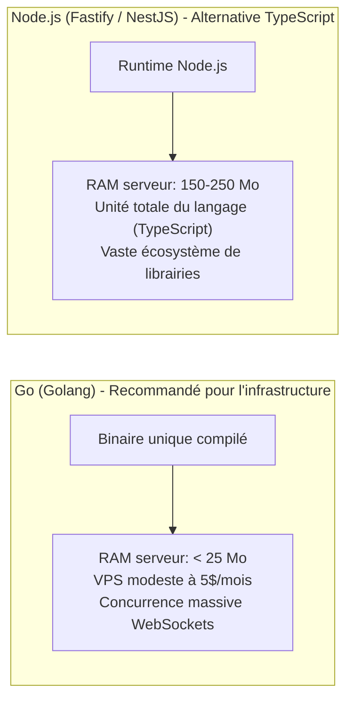

# Étude Comparative & Arbitrage de la Pile Technologique (Tech Stack)
## Logiciel Hybride de Gestion d'Auto-École (Contexte Africain)

---

## 1. Critères d'Évaluation adaptés au Terrain Africain

Pour sélectionner les technologies de ce projet, les critères prioritaires ne sont pas les modes technologiques, mais les contraintes réelles du terrain :

1. **Faible consommation de ressources (RAM & CPU)** : Le logiciel Desktop doit tourner de manière fluide sur des ordinateurs de bureau modestes (PC reconditionnés, Intel Celeron / Core i3 de 4e à 8e génération, 4 Go à 8 Go de RAM, disques parfois lents).
2. **Support des périphériques locaux** : Prise en charge native et robuste des imprimantes de tickets de caisse thermiques (ports USB/Série avec protocole ESC/POS) et des webcams USB pour les photos.
3. **Économie de bande passante (Data 3G/4G)** : L'application web mobile des moniteurs et élèves doit être ultra-légère (chargement rapide avec un forfait data limité).
4. **Partage maximal de code** : Utiliser un écosystème cohérent pour éviter de réécrire 3 fois la même logique métier entre le Desktop, le Web et le Mobile.
5. **Autonomie & Zéro Maintenance Serveur Local** : La base de données du PC d'agence ne doit pas nécessiter un administrateur système sur place pour redémarrer des services complexes.

---

## 2. Comparatif Desktop : Quel socle pour le poste de l'agence ?

### Matrice Comparative des Technologies Desktop

| Critère | **Tauri v2 (Rust + Web)** *(Recommandé)* | **Electron (Chromium + Node)** | **Flutter Desktop (Dart)** | **C# / .NET WPF** |
| :--- | :---: | :---: | :---: | :---: |
| **Consommation RAM** | **35 - 60 Mo** (Ultra-léger) | 350 - 650 Mo (Gourmand) | 120 - 200 Mo (Moyen) | 80 - 150 Mo (Faible) |
| **Taille de l'installateur** | **~10 - 15 Mo** | ~120 - 180 Mo | ~45 - 60 Mo | ~60 - 90 Mo |
| **Fluidité sur vieux PC (4 Go RAM)**| ⭐⭐⭐⭐⭐ (Parfaite) | ⭐⭐ (Risque de ralentissements) | ⭐⭐⭐ (Correcte) | ⭐⭐⭐⭐ (Très bonne) |
| **Intégration Imprimante Thermique**| ⭐⭐⭐⭐⭐ (Direct via port série/USB Rust) | ⭐⭐⭐⭐ (Via modules Node) | ⭐⭐⭐ (Plugins desktop instables) | ⭐⭐⭐⭐⭐ (Natif Windows) |
| **Partage de code avec le Web/PWA** | ⭐⭐⭐⭐⭐ (100% de l'UI Web partagée)| ⭐⭐⭐⭐⭐ (100% partagée) | ⭐⭐ (Langage Dart séparé) | ❌ (0% partagé avec le Web) |
| **Sécurité du binaire** | ⭐⭐⭐⭐⭐ (Rust compilé natif) | ⭐⭐ (Code JS facile à décompiler)| ⭐⭐⭐⭐ (Binaire compilé) | ⭐⭐⭐ (Bytecode décompilable)|

#### 💡 Verdict Desktop : **Tauri v2**
* **Pourquoi ?** Tauri v2 utilise le composant Webview2 déjà préinstallé nativement sur Windows 10 et 11. Au lieu d'embarquer un navigateur Chromium entier (comme Electron qui sature la mémoire des petits ordinateurs), Tauri ne consomme que **35 à 50 Mo de RAM**.
* **Avantage décisif** : Toutes les interfaces utilisateur (écrans de saisie, caisse, formulaires) sont écrites en HTML/CSS/JS (Vue.js ou React) et sont **strictement réutilisables à 100 % sur le web**.

---

## 3. Moteur de Base de Données : Local vs Cloud

### 3.1. Sur le PC Desktop d'Agence (Base Locale) : **SQLite (avec chiffrement SQLCipher)**
* **Pourquoi pas un serveur MySQL ou PostgreSQL local sur le PC de la secrétaire ?**
  - Un serveur de base de données local (service Windows en tâche de fond) risque d'être arrêté par un antivirus, saturé par une coupure de courant brutale, ou de bloquer le PC au démarrage.
* **Le choix SQLite** :
  - **Zéro installation / Zéro maintenance** : La base de données est un fichier unique (`autoecole_local.db`) stocké dans le dossier sécurisé de l'application.
  - **Résistance absolue aux coupures de courant** : SQLite en mode WAL (*Write-Ahead Logging*) est conçu pour survivre à une extinction brutale du PC sans corrompre les données.
  - **Sécurité anti-vol** : En utilisant **SQLCipher**, la base locale est chiffrée avec une clé AES-256. Même si un employé malveillant copie le fichier sur une clé USB, il ne peut pas lire les données de caisse ou les candidats.

### 3.2. Sur le Serveur Central Cloud : **PostgreSQL**
* **Pourquoi PostgreSQL ?**
  - Robustesse reconnue pour les données financières.
  - Support natif du type `JSONB` pour stocker les payloads de la file de synchronisation (`journal_sync_events`).
  - **Row-Level Security (RLS)** intégrée pour verrouiller le cloisonnement multi-agences (`auto_ecole_id`) directement au niveau moteur.

---

## 4. Application Web & Mobile (Moniteurs & Élèves) : **PWA (Progressive Web App)**

### Framework Frontend Web & Desktop Recommandé : **Vue 3 + Vite + TailwindCSS**
* **Légèreté maximale** : Vue 3 produit des bundles très compacts, essentiels pour les réseaux 3G/4G où la donnée coûte cher.
* **Partage universel de composants** : Les mêmes composants (boutons, formulaires d'élèves, widgets de planning, tableaux de bord) sont utilisés dans le logiciel Desktop (Tauri) et dans la PWA Web.
* **Mode PWA Natif (`vite-plugin-pwa`)** : Installation en 1 clic sur l'écran d'accueil du smartphone d'un moniteur ou d'un apprenant sans passer par le Google Play Store ou l'App Store.

---

## 5. Backend Cloud & API Hub : **Go (Golang) vs Node.js (Fastify/NestJS)**

| Critère | **Go (Golang)** *(Choix Performance/Coût)* | **Node.js (NestJS / Fastify)** *(Choix Stack Unifiée)* |
| :--- | :---: | :---: |
| **Coût d'hébergement serveur** | ⭐⭐⭐⭐⭐ (Tourne sur un petit VPS à 4-5$/mois) | ⭐⭐⭐⭐ (Nécessite 1 à 2 Go RAM minimum) |
| **Empreinte mémoire serveur** | **~20 - 30 Mo** | ~150 - 300 Mo |
| **Vitesse de traitement des Webhooks MoMo** | Instantanée (Quelques millisecondes) | Très rapide |
| **Unité de langage** | Frontend en TS / Backend en Go | Frontend & Backend 100% TypeScript |

#### Synthèse Backend :
- **Option 1 (Optimisation Coûts & Robustesse)** : **Go (Golang)**. Idéal pour une solution SaaS en Afrique où la marge est précieuse : un seul serveur à 5$/mois peut facilement synchroniser des centaines d'auto-écoles et délivrer des milliers de Webhooks Mobile Money et messages WhatsApp simultanés.
- **Option 2 (Vitesse de Développement & Équipe Mono-Langage)** : **Node.js avec Fastify ou NestJS (TypeScript)**. Permet aux développeurs d'utiliser TypeScript sur toute la chaîne (Desktop, Web, API).

---

## 6. Récapitulatif Final de la Stack Recommandée

| Composant | Technologie Choisie | Justification Clé |
| :--- | :--- | :--- |
| **Desktop (Secrétaire & Manager)** | **Tauri v2 + Vue 3** | Empreinte RAM ridicule (40 Mo), démarrage instantané, support direct des imprimantes thermiques ESC/POS via USB. |
| **Base Locale Desktop** | **SQLite chiffré (SQLCipher)** | Fichier unique zéro-maintenance, résistant aux coupures de courant et chiffré contre le vol. |
| **Web & Mobile (Moniteurs & Élèves)** | **PWA Vue 3 + Vite** | Pas d'installation lourde depuis les stores, accès direct par lien WhatsApp, consommation data minimale. |
| **API Centrale Cloud** | **Go (Golang)** *(ou Node.js NestJS)* | Gestion temps réel des Webhooks de paiement et des files de synchronisation avec un coût d'infrastructure minime. |
| **Base de Données Cloud** | **PostgreSQL** | Fiabilité bancaire pour les paiements, sécurité multi-tenancy native (RLS), support JSONB. |
| **Services Tiers (Afrique)** | **Passerelles MoMo & Passerelle SMS/WhatsApp** | Webhooks Wave / CinetPay / FedaPay + API SMS/WhatsApp (Twilio, Infobip ou passerelle GSM locale). |
