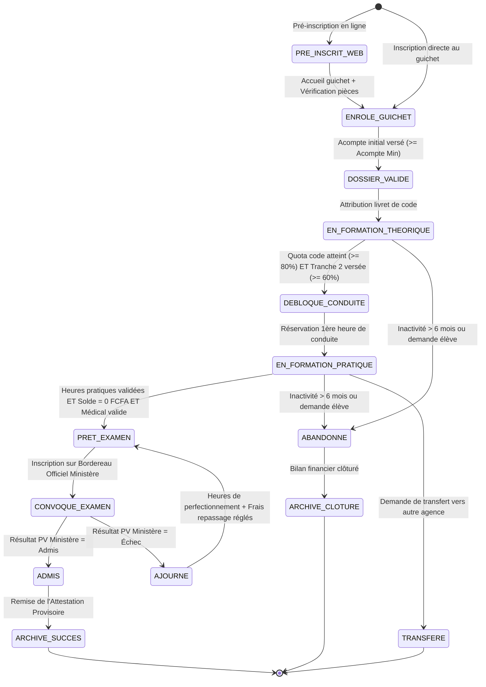
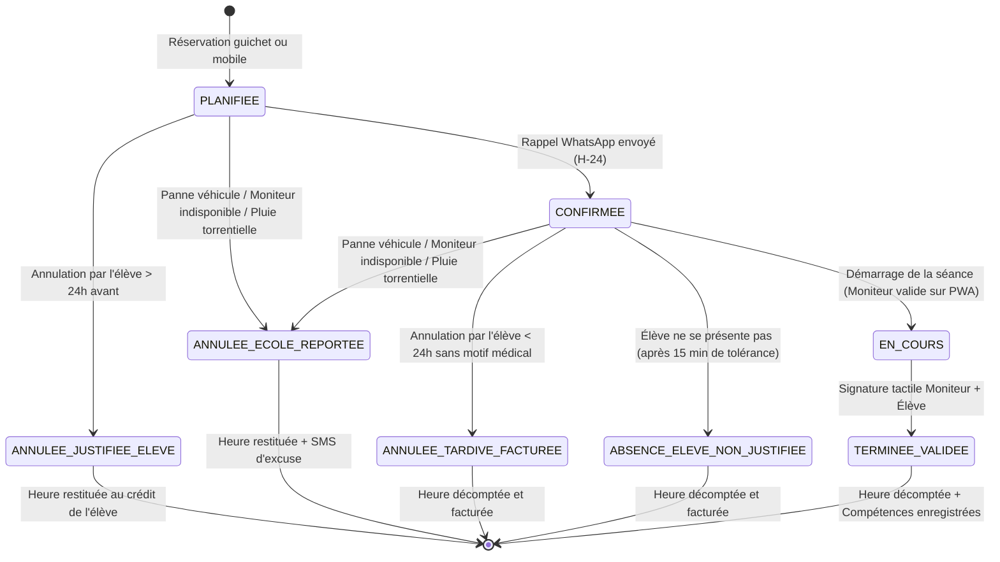
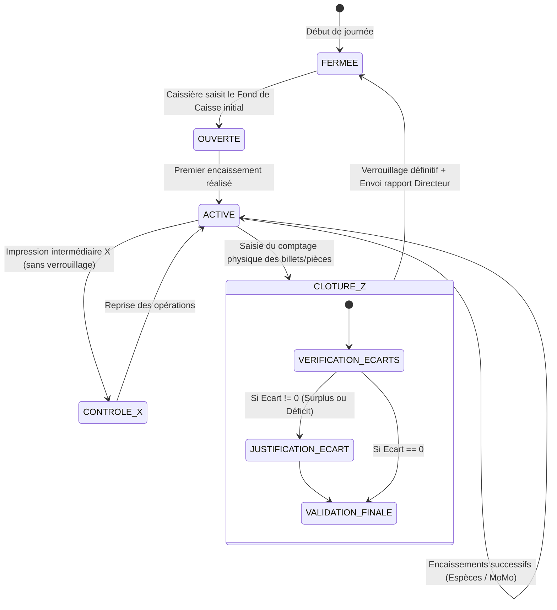
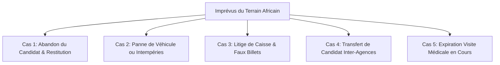

# Dossier de Conception Détaillée (DCD)
## Logiciel Hybride de Gestion d'Auto-École

---

## 1. Diagrammes d'États-Transitions Formels (Cycles de Vie)

Chaque entité centrale du système est modélisée sous forme d'une **machine à états finis** régie par des événements déclencheurs et des conditions de garde strictes.

### 1.1. Cycle de Vie Formel du Dossier Candidat



#### Conditions de Garde & Règles de Transition
* `ENROLE_GUICHET` ➔ `DOSSIER_VALIDE` :
  - **Garde** : `paiement_initial >= formule.acompte_minimum`.
* `EN_FORMATION_THEORIQUE` ➔ `DEBLOQUE_CONDUITE` :
  - **Garde** : `total_heures_code_effectuees >= formule.heures_theoriques * 0.8` **ET** `cumul_paiements >= formule.prix_total * 0.6` *(Sauf dérogation explicite par code Manager)*.
* `EN_FORMATION_PRATIQUE` ➔ `PRET_EXAMEN` :
  - **Garde stricte et infranchissable** : `solde_restant == 0` **ET** `visite_medicale_expire_le > date_examen_prevue` **ET** `heures_conduite_restantes == 0`.

---

### 1.2. Cycle de Vie Formel d'une Séance de Conduite Pratique



---

### 1.3. Cycle de Vie d'une Session de Caisse & d'une Transaction



---

## 2. Cas d'Utilisation Détaillés & Gestion des Exceptions Terrain

Dans le contexte des auto-écoles africaines, le logiciel doit exceller dans la gestion des **imprévus réels** :



### Cas 1 : Abandon du Candidat avec Demande de Remboursement
* **Déclencheur** : Le candidat déménage, abandonne la formation ou réclame un remboursement.
* **Acteur** : Secrétaire + Validation obligatoire du Directeur.
* **Pré-conditions** : Dossier actif avec des versements enregistrés.
* **Algorithme de Résolution Financière** :
  1. Le système calcule le coût consommé :  
     `Coût_Consommé = Frais_Dossier_Fixes (non remboursables) + (Heures_Code_Effectuées * Tarif_Heure_Code) + (Heures_Conduite_Consommées * Tarif_Heure_Conduite)`.
  2. Le système calcule le solde net :  
     `Solde_Remboursable = Total_Versements_Effectués - Coût_Consommé`.
  3. Si `Solde_Remboursable > 0` :
     - Le système génère une **Pièce de Sortie de Caisse / Avoir** avec motif obligatoire *"Remboursement suite abandon"*.
     - Le Directeur doit saisir son code secret pour valider le décaissement.
     - Un reçu de décharge est imprimé et signé conjointement par le candidat et la caissière.
  4. Le statut du dossier passe immédiatement à `ABANDONNE`.

---

### Cas 2 : Panne de Véhicule École ou Pluies Diluviennes
* **Déclencheur** : Un véhicule d'apprentissage tombe en panne le matin (ex: embrayage, surchauffe) ou une pluie torrentielle inonde la zone d'apprentissage.
* **Acteur** : Secrétaire ou Moniteur en chef.
* **Workflow de Gestion de Crise en 2 Clics** :
  1. L'opérateur sélectionne le véhicule impacté et clique sur **"Déclarer Indisponible"** (Plage horaire : Journée entière ou heures précises).
  2. Le système liste immédiatement tous les élèves programmés sur ce véhicule ce jour-là (ex: 8 élèves).
  3. **Option A (Réaffectation Express)** : Si un autre véhicule de la flotte est libre, le système propose de transférer les créneaux en 1 clic.
  4. **Option B (Annulation & Recrédit Massif)** :
     - Les créneaux sont annulés avec le statut `ANNULEE_ECOLE_REPORTEE`.
     - L'heure est recréditée au compte de chaque élève sans aucune pénalité.
     - **Envoi automatique d'un message WhatsApp/SMS groupé d'excuse** :  
       `« Bonjour [Prénom], en raison d'un problème mécanique imprévu sur le véhicule école, votre séance de ce jour à 14h est reportée. Votre heure reste intacte. Veuillez vous connecter pour choisir un nouveau créneau ou contacter le secrétariat. Avec nos excuses. »`

---

### Cas 3 : Détection d'un Faux Billet ou Erreur de Caisse
* **Déclencheur** : La secrétaire découvre en fin de journée un faux billet de 10 000 FCFA ou commet une erreur de saisie sur le montant d'une tranche.
* **Règle absolue d'audit** : Aucun enregistrement de paiement ne peut être effacé de la base de données.
* **Procédure de Régularisation** :
  1. L'écriture d'origine erronée reste visible dans le journal de caisse avec sa référence.
  2. La secrétaire clique sur **"Régulariser une écriture"** :
     - Elle saisit le motif précis (ex: *"Erreur de saisie montant réel 30 000 au lieu de 50 000"* ou *"Billet faux détecté"*).
     - Le système exige le mot de passe ou code PIN du Directeur pour confirmation.
     - Le système émet une écriture compensatoire d'ajustement (`AVOIR_COMPTABLE`).
  3. Le solde du dossier de l'élève est instantanément recalculé et mis à jour.
  4. Une notification d'alerte silencieuse est consignée dans l'audit de direction.

---

### Cas 4 : Transfert d'un Candidat vers une Autre Agence du Réseau
* **Déclencheur** : Un élève inscrit à l'agence de Yopougon déménage et souhaite continuer ses cours de conduite à l'agence de Cocody.
* **Procédure** :
  1. La secrétaire de l'agence de départ initie un **"Transfert de Dossier"** vers l'agence d'arrivée.
  2. Le système synchronise l'historique complet :
     - Le décompte exact des heures de code et de conduite déjà effectuées.
     - Le livret d'apprentissage numérique avec les compétences déjà validées par le premier moniteur.
     - La situation comptable exacte (ce qui a été payé et le solde restant dû).
  3. L'élève continue sa formation sans repartir de zéro et sans recalcul manuel.

---

### Cas 5 : Expiration de la Visite Médicale en Cours de Formation
* **Déclencheur** : Le certificat de visite médicale arrive à expiration (validité légale dépassée) avant que l'élève ne soit présenté à l'examen.
* **Garde Système** :
  - **30 jours avant péremption** : Une pastille orange clignote sur la fiche de l'élève et sur le tableau de bord du secrétariat : *"Visite médicale expire le [Date]"*.
  - Un SMS/WhatsApp de rappel est envoyé à l'élève : *"Pensez à renouveler votre certificat médical pour ne pas bloquer votre inscription à l'examen"*.
  - **À péremption** : Le système **interdit formellement** l'ajout de l'élève sur le bordereau officiel du Ministère tant que la date de la nouvelle visite médicale n'est pas saisie et le document scanné.

---

## 3. Matrice des Droits d'Accès (RBAC) & Règles Métier Anti-Fraude

### 3.1. Matrice des Permissions par Profil

| Fonctionnalité / Action | Super-Admin | Directeur / Gérant | Secrétaire / Caissière | Moniteur | Élève |
| :--- | :---: | :---: | :---: | :---: | :---: |
| **Créer / Modifier un Candidat** | ✅ | ✅ | ✅ | ❌ | 👁️ (Profil) |
| **Encaisser une tranche & Imprimer reçu**| ✅ | ✅ | ✅ | ❌ | ❌ |
| **Annuler un encaissement (Émettre un avoir)**| ✅ | ✅ (Seul habilité)| ❌ (Requiert code Dir)| ❌ | ❌ |
| **Accorder une remise tarifaire commerciale**| ✅ | ✅ (Jusqu'au max)| ❌ (Requiert code Dir)| ❌ | ❌ |
| **Dérogation Conduite sans tranche versée**| ✅ | ✅ (Seul habilité)| ❌ (Requiert code Dir)| ❌ | ❌ |
| **Clôturer la caisse (Rapport Z de caisse)**| ✅ | ✅ (Validation) | ✅ (Saisie comptage) | ❌ | ❌ |
| **Consulter le Chiffre d'Affaires Global**| ✅ | ✅ | ❌ | ❌ | ❌ |
| **Gérer la Flotte (Entretiens, Assurances)**| ✅ | ✅ | 👁️ (Disponibilité) | 👁️ (Kilométrage) | ❌ |
| **Noter les compétences de conduite** | ✅ | 👁️ (Audit) | ❌ | ✅ (En voiture) | 👁️ (Lecture) |
| **Signer la fiche de fin de séance** | ❌ | ❌ | ❌ | ✅ (Signature) | ✅ (Signature)|
| **Générer le Bordereau d'Examen d'État** | ✅ | ✅ | ✅ | ❌ | ❌ |
| **Saisir les Résultats du PV d'Examen** | ✅ | ✅ | ✅ | 👁️ (Résultats) | 👁️ (Résultats)|

---

### 3.2. Le Système de Dérogation par Clé / Code Manager (Override)

Lorsqu'une secrétaire est face à un cas particulier au guichet (ex: un élève fidèle qui demande une remise de 10 000 FCFA autorisée verbalement par le patron, ou qui doit faire une heure de conduite urgente avant d'avoir réglé sa tranche 2) :

```text
+-----------------------------------------------------------------------------------+
|  [!] ACTION PROTÉGÉE : DÉROGATION CONDUITE SANS VERSEMENT DU SEUIL MINIMUM        |
+-----------------------------------------------------------------------------------+
|  Règle du Système : L'élève KOUASSI Yao n'a versé que 50 000 FCFA sur 150 000.    |
|  Le seuil minimal exigé pour démarrer la conduite est de 90 000 FCFA (60%).       |
|                                                                                   |
|  Pour déroger exceptionnellement à cette règle, veuillez composer le code :       |
|                                                                                   |
|  CODE DÉROGATION MANAGER (4 ou 6 chiffres) : [ * * * * ]                         |
|  MOTIF OBLIGATOIRE : [ Accord téléphonique Directeur du 19/10/2026            ]   |
|                                                                                   |
|  [ ÉCHAP : Annuler ]                              [ ENTRÉE : Valider Dérogation ] |
+-----------------------------------------------------------------------------------+
```

* **Traçabilité totale** : La dérogation est enregistrée dans la table `audit_logs` avec l'horodatage, l'ID de la machine, le compte secrétaire et le motif saisi. Le Directeur retrouve toutes les dérogations accordées dans son rapport hebdomadaire.

---

## 4. Maquettage des Autres Écrans Clés (Wireframes Détaillés)

---

### 4.1. Écran Desktop : Planning Dynamique des Séances de Conduite (Vue Grille / Timeline)

Cet écran permet à la secrétaire et au directeur de visualiser d'un seul coup d'œil l'ensemble de la flotte et des moniteurs pour la journée :

```text
+---------------------------------------------------------------------------------------------------------------------------------------+
|  PLANNING DES COURS DE CONDUITE | [ < Hier ] [ AUJOURD'HUI : 19/10/2026 ] [ Demain > ]   Filtre : [ Tous Véhicules v ]   [F5] Rafraîchir|
+---------------------------------------------------------------------------------------------------------------------------------------+
| VÉHICULE / MONITEUR    | 07h00 - 08h30      | 08h30 - 10h00      | 10h00 - 11h30      | 11h30 - 13h00      | 14h00 - 15h30      ... |
+------------------------+--------------------+--------------------+--------------------+--------------------+--------------------+-----+
| PEUGEOT 208 (Manuelle) | [ KOUASSI Jean   ] | [ KONE Fatou     ] | [ LIBRE / DISPO  ] | [ OUATTARA Ali   ] | [ ENTRETIEN PRÉVU] |     |
| Plaque: 4892 KH 01     | Moniteur: BAKAYOKO | Moniteur: BAKAYOKO | + Nouveau cours    | Moniteur: BAKAYOKO | Garage Vidange     |     |
| (🟢 Disponible)        | Permis B (H 12/20) | Permis B (H 04/20) |                    | Permis B (H 19/20) | (Indisponible)     |     |
+------------------------+--------------------+--------------------+--------------------+--------------------+--------------------+-----+
| TOYOTA YARIS (Autom.)  | [ LIBRE / DISPO  ] | [ DIALLO Mamadou ] | [ DIALLO Mamadou ] | [ SOULEYMANE B.  ] | [ LIBRE / DISPO  ] |     |
| Plaque: 1109 JJ 01     | + Nouveau cours    | Moniteur: TIEHI    | Moniteur: TIEHI    | Moniteur: TIEHI    | + Nouveau cours    |     |
| (🟢 Disponible)        |                    | Permis B (H 08/20) | (Séance double)    | Permis B (H 15/20) |                    |     |
+------------------------+--------------------+--------------------+--------------------+--------------------+--------------------+-----+
| MOTO TVS 125 (Permis A)| [ YAO Kouadio    ] | [ LIBRE / DISPO  ] | [ TOURE Moussa   ] | [ LIBRE / DISPO  ] | [ LIBRE / DISPO  ] |     |
| Plaque: 8832 AB 01     | Moniteur: KOUAME   | + Nouveau cours    | Moniteur: KOUAME   | + Nouveau cours    | + Nouveau cours    |     |
+------------------------+--------------------+--------------------+--------------------+--------------------+--------------------+-----+
| LÉGENDE COULEURS :  [Bleu: Confirmé]  [Vert: Libre]  [Orange: En attente confirmation]  [Gris: Indisponible / Entretien]  [Rouge: Conflit]|
+---------------------------------------------------------------------------------------------------------------------------------------+
```

* **Fonctionnalités Clés** :
  - **Glisser-Déposer (Drag & Drop)** : Déplacer un créneau d'un véhicule à un autre en cas de panne imprévue.
  - **Contrôle de collision automatique** : Le système empêche physiquement d'assigner le même moniteur sur deux véhicules différents au même horaire.

---

### 4.2. Écran Mobile PWA : Interface Moniteur en Voiture (Usage Tactile 1 Main)

Conçu pour une ergonomie optimale en plein soleil dans l'habitacle : **fond contrasté, boutons très larges (hauteur minimale 48px), mode hors-ligne natif**.

```text
+-------------------------------------------------------+
|  [🚗] AUTO-ÉCOLE LA RÉFÉRENCE             [● 4G] 10:02|
|  Moniteur : M. Bakayoko (Agence Cocody)               |
+-------------------------------------------------------+
|  SÉANCE EN COURS : 10h00 - 11h30 (90 min)             |
|                                                       |
|  Élève : KOUASSI Yao Jean-Luc                         |
|  Véhicule : Peugeot 208 (4892 KH 01)                  |
|  Progression : Heure 12 sur 20                        |
+-------------------------------------------------------+
|  RELEVÉ KILOMÉTRIQUE :                                |
|  Km Départ : [ 148 250 ]   Km Arrivée : [ 148 274 ]   |
+-------------------------------------------------------+
|  GRILLE DES COMPÉTENCES ÉVALUÉES CE JOUR :            |
|                                                       |
|  1. Démarrage en côte & Arrêt précis                  |
|     ( ) Non Acquis   ( ) En Cours   (•) ACQUIS        |
|                                                       |
|  2. Rétrogradation 3e -> 2e et virage à droite        |
|     ( ) Non Acquis   (•) EN COURS   ( ) Acquis        |
|                                                       |
|  3. Créneau et stationnement arrière                  |
|     (•) NON ACQUIS   ( ) En Cours   ( ) Acquis        |
+-------------------------------------------------------+
|  OBSERVATION DU MONITEUR :                            |
|  [ Bonne maîtrise du freinage, insister sur le créneau]
+-------------------------------------------------------+
|  VALIDATION FINALE DE LA SÉANCE :                     |
|                                                       |
|  Signature Tactile de l'Élève :                       |
|  +-------------------------------------------------+  |
|  |             [ Signature Yao Jean-Luc ]          |  |
|  +-------------------------------------------------+  |
|                                                       |
|  [ ✓ CLÔTURER LA SÉANCE & DÉCOMPTER L'HEURE (VERT) ]  |
+-------------------------------------------------------+
```

---

### 4.3. Écran Desktop : Tableau de Bord Direction / Pilotage (Directeur)

```text
+---------------------------------------------------------------------------------------------------------------------------------------+
|  TABLEAU DE BORD DIRECTION | Auto-École La Référence | Agence : [ Toutes les agences v ]   Période : [ Ce Mois-ci v ]   [Export PDF]  |
+---------------------------------------------------------------------------------------------------------------------------------------+
|                                                                                                                                       |
|   INDICATEURS CLÉS FINANCIERS (KPI) :                                                                                                 |
|   +--------------------------+--------------------------+--------------------------+--------------------------+                       |
|   | CHIFFRE D'AFFAIRES DU MOIS| ENCAISSEMENTS CASH/MOMO  | SOLDE RESTANT À RECOUVRER| ÉCARTS DE CAISSE Z MOIS  |                       |
|   | 6 450 000 FCFA           | 4 850 000 FCFA (75%)     | 1 600 000 FCFA (Impayés) | 0 FCFA (Conforme)        |                       |
|   | ↑ +12% vs mois dernier   | Cash: 60% | MoMo: 40%    | 24 dossiers concernés    | 0 anomalie détectée      |                       |
|   +--------------------------+--------------------------+--------------------------+--------------------------+                       |
|                                                                                                                                       |
|   PERFORMANCE PÉDAGOGIQUE & EXAMENS D'ÉTAT :                                                                                          |
|   +-----------------------------------------------------------+-----------------------------------------------------------+           |
|   | TAUX DE RÉUSSITE GLOBAL AUX EXAMENS (Session d'Octobre)   | TOP MONITEURS (Taux de Réussite Candidats)                |           |
|   |                                                           |                                                           |           |
|   | Présentés : 32 candidats                                  | 1. M. Bakayoko   : 88% de réussite (15 présentés, 13 admis)|          |
|   | Admis       : 26 candidats  ===> [ 81.25 % DE SUCCÈS ]    | 2. M. Tiehi      : 76% de réussite (12 présentés, 9 admis) |          |
|   | Ajournés    : 6 candidats (Code: 2 | Conduite: 4)         | 3. M. Kouame     : 72% de réussite (5 présentés, 4 admis)  |          |
|   +-----------------------------------------------------------+-----------------------------------------------------------+           |
|                                                                                                                                       |
|   ALERTES ADMINISTRATIVES ET FLOTTE PRIORITAIRES (À TRAITER D'URGENCE) :                                                              |
|   • [🚨 VÉHICULE] Toyota Yaris (1109 JJ 01) : Visite Technique expire dans 8 jours (le 27/10/2026). Programmer contrôle.             |
|   • [⚠️ VÉHICULE] Peugeot 208 (4892 KH 01) : Vidange dépassée de 450 km (Km actuel: 148 450 km).                                      |
|   • [⚠️ CANDIDAT] 3 candidats ont leur visite médicale expirant avant la prochaine session ministérielle du 15 Novembre.               |
|                                                                                                                                       |
|   DERNIÈRES DÉROGATIONS ACCORDÉES :                                                                                                   |
|   • 19/10 14:15 | Secrétaire Aminata | Écriture avoir 10 000 FCFA sur Dossier #0042 (Code Manager utilisé)                           |
+---------------------------------------------------------------------------------------------------------------------------------------+
```

---

## 5. Synthèse & Prise de Décision Finale de Conception

Avec l'adjonction de ces briques :
1. ✅ **Chaque transition d'état** est mathématiquement verrouillée par des conditions de garde (aucun élève ne passe à l'examen sans solde à zéro).
2. ✅ **Chaque imprévu du terrain africain** (coupures, pluies torrentielles, pannes d'embrayage, abandons, contestations de caisse) possède une procédure logicielle pré-établie.
3. ✅ **La sécurité anti-fraude** est garantie par une séparation des rôles et une traçabilité inviolable des dérogations.
4. ✅ **L'ergonomie de l'ensemble des acteurs** (Secrétaire au clavier, Moniteur en voiture sur mobile, Directeur sur son tableau de bord) est intégralement modélisée.
