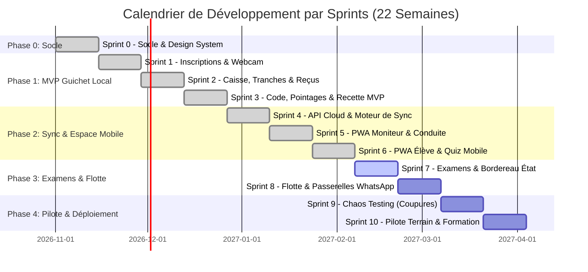

# Feuille de Route & Plan de Développement par Sprints (Roadmap MVP à V1)
## Logiciel Hybride de Gestion d'Auto-École

---

## 1. Vue d'Ensemble & Stratégie de Phasage

Le cycle de développement est structuré en **10 Sprints de 2 semaines (environ 5 mois au total)**, répartis en **4 grandes phases jalonnées**. Cette approche garantit qu'une version utilisable en conditions réelles (le MVP) est disponible dès la 8ème semaine.

---

## 2. Découpage Détaillé des Sprints & Critères d'Acceptation

### Phase 0 : Socle Technique & Ergonomie (Semaines 1 - 2)

#### Sprint 0 : Initialisation de l'Architecture & Design System
* **Objectif** : Mettre en place l'environnement hybride unifié et le design system prêt pour la saisie clavier.
* **Livrables Clés** :
  - Environnement Tauri v2 configuré avec Vue 3, Vite et TailwindCSS.
  - Base locale SQLite intégrée avec support du chiffrement SQLCipher.
  - Schéma de base PostgreSQL Cloud initialisé avec politiques RLS.
  - Composants graphiques de base (Formulaires guidés au clavier, modals de confirmation, tableau de données réactif).
* **Critère d'acceptation (DoD)** : L'application Desktop démarre en moins d'une seconde sur un PC 4 Go de RAM et affiche une interface fluide.

---

### Phase 1 : Le MVP Guichet d'Agence (Semaines 3 - 8)
*Ce jalon produit un logiciel Desktop 100% autonome capable de gérer une auto-école physique sans aucune connexion Internet.*

#### Sprint 1 : Enrôlement Candidats & Prise de Vue Webcam
* **User Stories** :
  - *En tant que secrétaire*, je veux saisir l'état civil d'un candidat en moins de 2 minutes au clavier pour ne pas faire attendre la file d'attente.
  - *En tant que secrétaire*, je veux capturer la photo de l'élève via la webcam en appuyant sur `Espace` pour générer automatiquement une photo 4x4 officielle.
  - *En tant que secrétaire*, je veux enregistrer les pièces d'identité et le statut médical avec génération du numéro de dossier unique (`REF-2026-B-0042`).
* **DoD** : Inscription complète testée en 1 minute 45 secondes sans toucher à la souris.

#### Sprint 2 : Caisse, Encaissement par Tranches & Impression Reçus Thermiques
* **User Stories** :
  - *En tant que caissière*, je veux encaisser une tranche en espèces ou Mobile Money via le raccourci `F2` en 15 secondes.
  - *En tant que caissière*, je veux que l'imprimante thermique USB sorte un reçu immédiat avec QR Code sécurisé et ouverture automatique du tiroir-caisse.
  - *En tant que gérant*, je veux clôturer la caisse en fin de journée (Rapport Z) avec vérification de l'écart entre le comptage physique et le théorique.
* **DoD** : Impression directe thermique ESC/POS fonctionnelle, calcul de rendu de monnaie instantané, aucun recalcul manuel de solde.

#### Sprint 3 : Code de la Route Local, Pointage des Présences & Recette MVP
* **User Stories** :
  - *En tant que secrétaire*, je veux pointer les présences des élèves en salle de code en 1 clic ou au clavier.
  - *En tant que gérant*, je veux consulter la liste des impayés et la liste des élèves assidus au code.
* **Jalon Majeur (Milestone 1 - MVP Opérationnel)** :
  - Validation sur site : L'auto-école peut couper sa box Internet et tourner pendant une semaine entière sur le logiciel Desktop seul.

---

### Phase 2 : Synchronisation Cloud & Espaces Mobiles (Semaines 9 - 14)

#### Sprint 4 : API Cloud, Multi-Tenancy & Moteur de Synchronisation Offline-First
* **Livrables Clés** :
  - Déploiement de l'API Cloud (Go ou NestJS) et de la base PostgreSQL.
  - Background Sync Worker : détection automatique du réseau, envoi de la file d'événements `journal_sync_events` par lots (`batches`).
  - Moteur d'arbitrage des conflits (Append-only financier, fusion champ par champ).
* **DoD** : Déconnexion simulée de 48h sur le Desktop : à la reconnexion, 100 inscriptions et paiements se synchronisent en moins de 3 secondes sans perte.

#### Sprint 5 : PWA Mobile Moniteur (Planning & Fiches de Conduite en Voiture)
* **User Stories** :
  - *En tant que moniteur*, je veux ouvrir mon planning sur mon smartphone le matin pour voir mes élèves du jour et les véhicules assignés.
  - *En tant que moniteur*, je veux noter les compétences travaillées en fin d'heure et faire signer l'élève sur l'écran tactile.
  - *En tant que moniteur*, je veux que l'heure soit décomptée automatiquement du forfait de l'élève.
* **DoD** : L'application web mobile s'installe en 1 clic ("Ajouter à l'écran d'accueil"), pèse moins de 2 Mo et fonctionne même en zone blanche temporaire.

#### Sprint 6 : PWA Mobile Candidat (Espace Apprenant)
* **User Stories** :
  - *En tant qu'élève*, je veux consulter mon solde restant dû et l'historique de mes reçus en toute transparence.
  - *En tant qu'élève*, je veux m'entraîner au code de la route 24/7 sur mon smartphone via des séries de quiz thématiques.
  - *En tant qu'élève*, je veux réserver un créneau de conduite sous réserve que ma tranche 2 soit réglée.
* **DoD** : Espace apprenant accessible par simple lien WhatsApp sans mot de passe complexe (authentification par SMS/WhatsApp OTP).

---

### Phase 3 : Examens d'État, Flotte & Alertes Automatiques (Semaines 15 - 18)

#### Sprint 7 : Examens d'État & Bordereaux Ministériels [RÉALISÉ ✅]
* **User Stories** :
  - *En tant que secrétaire*, je veux créer une session d'examen et filtrer automatiquement les candidats éligibles (solde = 0 FCFA, quotas validés >= 20h, médical OK).
  - *En tant que secrétaire*, je veux générer en 1 clic le **Bordereau Officiel du Ministère** au format A4 prêt à imprimer avec photos 4x4 et données d'identité.
  - *En tant que secrétaire*, je veux saisir les résultats du PV officiel (Admis/Ajourné/Absent) au clavier en moins de 2 minutes pour déclencher la publication automatique.
* **DoD Validé** :
  - Modèle de données SQLite & PostgreSQL Cloud : tables `sessions_examen` et `candidats_examen`.
  - Vue Métier Desktop accessible via `F9` ou `/?mode=examens` (`ExamensView.vue`).
  - Bordereau officiel d'examen A4 conforme aux normes du Ministère des Transports (`BordereauMinisterielModal.vue`) avec photos, CNI, cases d'émargement et cadre d'inspection d'État.
  - Module de saisie continue rapide du PV officiel au clavier (notes Code et Conduite, statut instantané).
  - Liens directs de convocation et de notification des résultats par WhatsApp en 1 clic.

#### Sprint 8 : Flotte Automobile & Passerelles SMS / WhatsApp
* **User Stories** :
  - *En tant que gérant*, je veux être alerté 15 jours avant l'expiration de l'assurance ou de la visite technique d'un véhicule.
  - *En tant que système*, expédier automatiquement les messages WhatsApp / SMS pour :
    - Confirmation d'inscription avec reçu numérique.
    - Convocations à l'examen officiel (date, heure, numéro de table).
    - Annonce officielle des résultats aux candidats admis et ajournés.
* **DoD** : Intégration réussie avec l'API SMS/WhatsApp et les webhooks de paiement Mobile Money.

---

### Phase 4 : Résilience, Pilote & Déploiement (Semaines 19 - 22)

#### Sprint 9 : Tests de Résilience Terrain (Chaos Testing Spécifique Afrique)
* **Batterie de Tests Réels** :
  1. *Test de Coupure Électrique Brutale* : Arrêt forcé de l'ordinateur de bureau au moment précis où un reçu thermique est en cours d'enregistrement -> La base SQLite ne doit présenter aucune corruption.
  2. *Test de Panne Réseau Prolongée* : 7 jours de coupure Internet simulée en agence avec 50 inscriptions et 120 encaissements locaux -> Synchronisation parfaite dès le rebranchement du câble.
  3. *Test de Bourrage Papier Imprimante* : Réimpression sécurisée d'un duplicata marqué "DUPLICATA" sans générer de double écriture comptable.

#### Sprint 10 : Déploiement Pilote en Auto-École & Formation
* **Activités** :
  - Installation sur site dans 1 ou 2 auto-écoles partenaires pilotes.
  - Formation du personnel (Secrétaire : raccourcis clavier ; Moniteurs : notation mobile).
  - Recueil des retours d'usage et micro-ajustements ergonomiques.
  - Clôture du projet et passage en phase d'exploitation / maintenance.

---

## 3. Matrice de Gouvernance & Rôles Recommandés

| Profil Équipe | Responsabilité Principale | Charge Estimée |
| :--- | :--- | :---: |
| **Tech Lead / Architecte Fullstack** | Conception système, moteur de synchronisation Tauri/Rust, API Cloud & BDD | 100% |
| **Développeur Frontend (Vue 3 / PWA)** | Interfaces guichet Desktop (ergonomie clavier) et PWA Mobile Moniteur/Élève | 100% |
| **Expert Métier / Référent Auto-École** | Validation de la conformité des bordereaux officiels, règles de caisse et tests terrain | 30% |

---

## 4. Indicateurs Clés de Succès (KPIs de Validation)

1. **Vitesse Guichet** : Un encaissement complet avec impression ticket réalisé en **moins de 20 secondes**.
2. **Tolérance aux Pannes** : **0% de perte de données** même après une coupure électrique ou une déconnexion Internet d'une semaine.
3. **Consommation Mémoire** : L'application Desktop ne dépasse jamais **60 Mo de RAM** sur le PC de l'agence.
4. **Adoption Moniteur** : Prise en main de la fiche de conduite mobile en **moins de 10 minutes** de formation.
