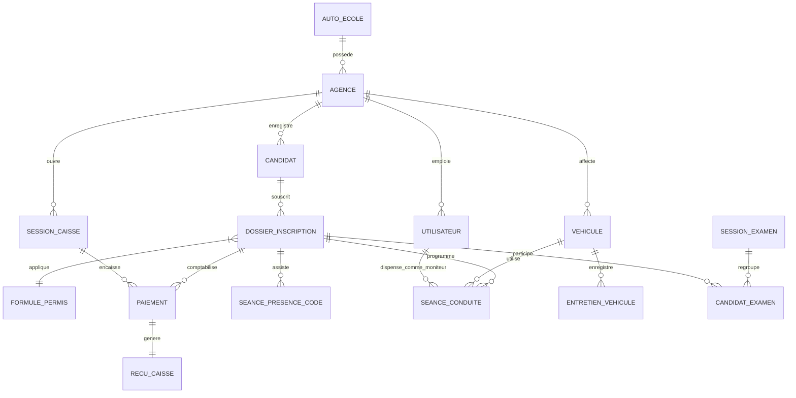

# Modélisation Détaillée de la Base de Données Relationnelle (SQL)
## Logiciel Hybride de Gestion d'Auto-École

---

## 1. Principes Directeurs de Conception de la Base de Données

Pour satisfaire aux contraintes d'une architecture hybride (Desktop hors-ligne + Web Cloud + Multi-agences en Afrique), le schéma respecte trois règles fondamentales :

1. **Clés Primaires en UUID v4 (`uuid`)** :
   - Au lieu d'identifiants séquentiels entiers (`1, 2, 3...`), **toutes les tables utilisent des UUID v4 générés côté client**.
   - *Pourquoi ?* Lorsqu'un poste Desktop est déconnecté d'Internet et inscrit 5 élèves ou émet 10 paiements, il peut créer ses enregistrements immédiatement sans risque de collision d'identifiants lors de la synchronisation avec le Cloud.
2. **Cloisonnement Strict par Agence (`auto_ecole_id` & `agence_id`)** :
   - Toutes les tables métier portent la clé étrangère de l'auto-école et de l'agence pour isoler rigoureusement les données (Multi-Tenancy).
3. **Traçabilité et Synchronisation Décentralisée** :
   - Chaque table comporte :
     - `created_at` (horodatage UTC de création)
     - `updated_at` (horodatage de la dernière modification)
     - `synced_at` (date/heure de validation par le Cloud)
     - `is_deleted` ou `deleted_at` (suppression logique / soft delete pour l'auditabilité légale).

---

## 2. Diagramme Entité-Association Global (ERD)

---

## 3. Dictionnaire des Tables & Structure Relationnelle

### Module 1 : Multi-Tenancy & Utilisateurs

#### Table `auto_ecoles` (L'entité auto-école / entreprise)
| Colonne | Type | Contrainte | Description |
| :--- | :--- | :--- | :--- |
| `id` | UUID | PRIMARY KEY | Identifiant unique de l'auto-école |
| `code_unique` | VARCHAR(20) | UNIQUE, NOT NULL | Code public (ex: `REF225`, `AVENIR_SN`) |
| `nom_commercial`| VARCHAR(150)| NOT NULL | Nom de l'auto-école |
| `numero_agrement`| VARCHAR(80) | NOT NULL | Numéro d'agrément ministériel officiel |
| `telephone` | VARCHAR(30) | NOT NULL | Numéro de téléphone principal |
| `email` | VARCHAR(120)| | Email officiel de l'école |
| `devise` | VARCHAR(10) | DEFAULT 'XOF' | Devise utilisée (XOF, XAF, GNF, USD) |
| `logo_url` | TEXT | | Lien vers le logo officiel |
| `created_at` | TIMESTAMPTZ | DEFAULT NOW() | Date de création |

#### Table `agences` (Les succursales physiques)
| Colonne | Type | Contrainte | Description |
| :--- | :--- | :--- | :--- |
| `id` | UUID | PRIMARY KEY | Identifiant unique de la succursale |
| `auto_ecole_id` | UUID | FK -> auto_ecoles | Auto-école parente |
| `nom` | VARCHAR(100)| NOT NULL | Ex: "Siège Plateau", "Agence Yopougon" |
| `adresse` | TEXT | NOT NULL | Quartier, commune, repère |
| `telephone` | VARCHAR(30) | NOT NULL | Contact guichet agence |
| `created_at` | TIMESTAMPTZ | DEFAULT NOW() | Date de création |

#### Table `utilisateurs` (Personnels & Candidats)
| Colonne | Type | Contrainte | Description |
| :--- | :--- | :--- | :--- |
| `id` | UUID | PRIMARY KEY | Identifiant unique du compte |
| `auto_ecole_id` | UUID | FK -> auto_ecoles | Rattachement |
| `agence_id` | UUID | FK -> agences | Agence principale d'affectation |
| `nom` | VARCHAR(80) | NOT NULL | Nom de famille |
| `prenoms` | VARCHAR(120)| NOT NULL | Prénoms |
| `telephone` | VARCHAR(30) | NOT NULL | Numéro WhatsApp/Mobile (sert d'identifiant) |
| `mot_de_passe_hash`| TEXT | | Hash sécurisé (Argon2 / BCrypt) ou PIN |
| `role` | VARCHAR(20) | NOT NULL | `DIRECTEUR`, `SECRETAIRE`, `MONITEUR`, `ELEVE` |
| `statut` | VARCHAR(20) | DEFAULT 'ACTIF' | `ACTIF`, `SUSPENDU`, `ARCHIVE` |

---

### Module 2 : Inscriptions, Candidats & Formules

#### Table `candidats` (Fiche d'état civil de l'apprenant)
| Colonne | Type | Contrainte | Description |
| :--- | :--- | :--- | :--- |
| `id` | UUID | PRIMARY KEY | Identifiant unique de l'élève |
| `auto_ecole_id` | UUID | FK -> auto_ecoles | |
| `agence_id` | UUID | FK -> agences | |
| `nom` | VARCHAR(80) | NOT NULL | Nom officiel |
| `prenoms` | VARCHAR(120)| NOT NULL | Prénoms officiels |
| `genre` | VARCHAR(1) | NOT NULL | `M` ou `F` |
| `date_naissance` | DATE | NOT NULL | Date de naissance |
| `lieu_naissance` | VARCHAR(100)| NOT NULL | Ville de naissance |
| `nationalite` | VARCHAR(60) | DEFAULT 'Ivoirienne'| Nationalité |
| `profession` | VARCHAR(100)| | Profession exercée |
| `quartier_residence`| VARCHAR(120)| | Quartier / Repère de domicile |
| `telephone_whatsapp`| VARCHAR(30)| NOT NULL | Téléphone principal de contact |
| `telephone_urgence` | VARCHAR(30)| | Contact tuteur / personne à prévenir |
| `groupe_sanguin` | VARCHAR(5) | | A+, A-, B+, B-, O+, O-, AB+, AB- |
| `photo_url` | TEXT | | Chemin local ou URL photo d'identité (4x4) |
| `type_piece_id` | VARCHAR(30) | NOT NULL | `CNI`, `PASSEPORT`, `ATTESTATION`, `CONSULAIRE`|
| `numero_piece_id` | VARCHAR(60) | NOT NULL | Numéro de la pièce |
| `date_expiration_piece`| DATE | | Date de fin de validité de la pièce |
| `visite_medicale_statut`| VARCHAR(20)| DEFAULT 'EN_ATTENTE' | `EN_ATTENTE`, `VALIDE_SANS_RESERVE`, `VALIDE_AVEC_VERRES`|
| `date_visite_medicale`| DATE | | Date de délivrance du certificat médical |
| `created_at` | TIMESTAMPTZ | DEFAULT NOW() | Date d'enrôlement |

#### Table `formules_permis` (Catalogue tarifaire des offres)
| Colonne | Type | Contrainte | Description |
| :--- | :--- | :--- | :--- |
| `id` | UUID | PRIMARY KEY | Identifiant de l'offre |
| `auto_ecole_id` | UUID | FK -> auto_ecoles | |
| `categorie_permis` | VARCHAR(5) | NOT NULL | `A`, `A1`, `B`, `C`, `D`, `E` |
| `intitule` | VARCHAR(100)| NOT NULL | Ex: "Permis B Standard", "Permis B VIP Accéléré" |
| `heures_theoriques`| INT | DEFAULT 20 | Quota d'heures de code incluses |
| `heures_pratiques` | INT | DEFAULT 20 | Quota d'heures de conduite incluses |
| `prix_total` | NUMERIC(12,2)| NOT NULL | Tarif officiel (ex: 150000.00 FCFA) |
| `acompte_minimum` | NUMERIC(12,2)| NOT NULL | Acompte obligatoire à l'inscription |
| `est_actif` | BOOLEAN | DEFAULT TRUE | Disponibilité dans le catalogue |

#### Table `dossiers_inscription` (Contrat liant le candidat à sa formation)
| Colonne | Type | Contrainte | Description |
| :--- | :--- | :--- | :--- |
| `id` | UUID | PRIMARY KEY | Identifiant du dossier |
| `auto_ecole_id` | UUID | FK -> auto_ecoles | |
| `agence_id` | UUID | FK -> agences | |
| `candidat_id` | UUID | FK -> candidats | Élève souscripteur |
| `formule_id` | UUID | FK -> formules_permis | Offre souscrite |
| `numero_dossier` | VARCHAR(40) | UNIQUE, NOT NULL | Ex: `REF-2026-B-0042` |
| `date_inscription`| DATE | DEFAULT CURRENT_DATE | Date du contrat |
| `montant_total` | NUMERIC(12,2)| NOT NULL | Montant total convenu |
| `remise_accordee` | NUMERIC(12,2)| DEFAULT 0.00 | Remise éventuelle accordée |
| `solde_restant` | NUMERIC(12,2)| NOT NULL | Montant restant dû calculé en temps réel |
| `statut_dossier` | VARCHAR(25) | DEFAULT 'EN_COURS' | `EN_COURS`, `PREPARE_EXAMEN`, `ADMIS`, `ABANDONNE` |

---

### Module 3 : Caisse, Encaissements & Reçus

#### Table `sessions_caisse` (Point de caisse de la journée)
| Colonne | Type | Contrainte | Description |
| :--- | :--- | :--- | :--- |
| `id` | UUID | PRIMARY KEY | Identifiant de la session |
| `agence_id` | UUID | FK -> agences | |
| `caissier_id` | UUID | FK -> utilisateurs | Opérateur responsable |
| `date_ouverture` | TIMESTAMPTZ | NOT NULL | Heure de début de service |
| `date_fermeture` | TIMESTAMPTZ | | Heure du Z de caisse |
| `fond_de_caisse` | NUMERIC(12,2)| DEFAULT 0.00 | Monnaie de départ en tiroir |
| `total_especes_theorique`| NUMERIC(12,2)| DEFAULT 0.00 | Somme calculée par le système |
| `total_especes_compte`| NUMERIC(12,2)| | Comptage physique des billets/pièces |
| `ecart_caisse` | NUMERIC(12,2)| | Écart constaté (Surplus ou Déficit) |
| `statut` | VARCHAR(15) | DEFAULT 'OUVERTE' | `OUVERTE`, `CLOTUREE` |

#### Table `paiements` (Registre comptable immuable des tranches)
| Colonne | Type | Contrainte | Description |
| :--- | :--- | :--- | :--- |
| `id` | UUID | PRIMARY KEY | Identifiant unique de transaction |
| `auto_ecole_id` | UUID | FK -> auto_ecoles | |
| `agence_id` | UUID | FK -> agences | |
| `dossier_id` | UUID | FK -> dossiers_inscription| Dossier crédité |
| `session_caisse_id`| UUID | FK -> sessions_caisse | Session de caisse active |
| `montant` | NUMERIC(12,2)| NOT NULL, CHECK > 0 | Montant versé (ex: 50000.00) |
| `mode_reglement` | VARCHAR(25) | NOT NULL | `ESPECES`, `WAVE`, `ORANGE_MONEY`, `MTN_MOMO`, `MOOV`, `VIREMENT` |
| `reference_transaction`| VARCHAR(80)| | N° SMS de reçu MoMo ou chèque |
| `date_paiement` | TIMESTAMPTZ | DEFAULT NOW() | Date et heure précise |
| `encaisse_par_id` | UUID | FK -> utilisateurs | Secrétaire/Caissière en charge |
| `est_annule` | BOOLEAN | DEFAULT FALSE | Immuable : un paiement ne s'efface pas, il s'annule par un avoir |
| `motif_annulation` | TEXT | | Obligatoire si `est_annule` = TRUE |

#### Table `recus_caisse` (Les tickets imprimés)
| Colonne | Type | Contrainte | Description |
| :--- | :--- | :--- | :--- |
| `id` | UUID | PRIMARY KEY | |
| `paiement_id` | UUID | FK -> paiements, UNIQUE | Paiement associé |
| `numero_recu` | VARCHAR(40) | UNIQUE, NOT NULL | Ex: `REC-2026-10-0089` |
| `code_securite_hash`| VARCHAR(64)| NOT NULL | Hash cryptographique anti-falsification |
| `nombre_impressions`| INT | DEFAULT 1 | Détecte les réimpressions (marquage "DUPLICATA") |

---

### Module 4 : Pédagogie (Code de la Route & Conduite Pratique)

#### Table `seances_code` & `presences_code` (Assiduité théorique)
* `seances_code` : Date, heure, thème traité (ex: Priorités, Signalisation, Dépassement), formateur.
* `presences_code` : `(seance_id, candidat_id, heure_pointage, score_test_du_jour)`.

#### Table `seances_conduite` (Leçons pratiques sur route)
| Colonne | Type | Contrainte | Description |
| :--- | :--- | :--- | :--- |
| `id` | UUID | PRIMARY KEY | Identifiant de la leçon |
| `auto_ecole_id` | UUID | FK -> auto_ecoles | |
| `dossier_id` | UUID | FK -> dossiers_inscription| Candidat au volant |
| `moniteur_id` | UUID | FK -> utilisateurs | Moniteur assis en passager |
| `vehicule_id` | UUID | FK -> vehicules | Véhicule auto-école utilisé |
| `date_seance` | DATE | NOT NULL | Date de la séance |
| `heure_debut` | TIME | NOT NULL | Heure programmée début |
| `heure_fin` | TIME | NOT NULL | Heure programmée fin |
| `duree_minutes` | INT | DEFAULT 60 | Durée en minutes (ex: 60 ou 120 min) |
| `statut` | VARCHAR(20) | DEFAULT 'PROGRAMME' | `PROGRAMME`, `EFFECTUE`, `ANNULE_ELEVE`, `REPORTE` |
| `commentaire_moniteur`| TEXT | | Remarques pédagogiques du moniteur |
| `signature_eleve_url` | TEXT | | Signature tactile capturée sur smartphone |
| `signature_moniteur_url`| TEXT | | Signature tactile du moniteur |

---

### Module 5 : Flotte Automobile

#### Table `vehicules` (Les voitures & motos de l'auto-école)
| Colonne | Type | Contrainte | Description |
| :--- | :--- | :--- | :--- |
| `id` | UUID | PRIMARY KEY | Identifiant du véhicule |
| `agence_id` | UUID | FK -> agences | Agence où stationne le véhicule |
| `immatriculation` | VARCHAR(30) | NOT NULL | N° de plaque minéralogique |
| `marque_modele` | VARCHAR(80) | NOT NULL | Ex: "Peugeot 208", "Toyota Yaris" |
| `type_boite` | VARCHAR(15) | DEFAULT 'MANUELLE' | `MANUELLE` ou `AUTOMATIQUE` |
| `kilometrage_actuel`| INT | DEFAULT 0 | Compteur kilométrique |
| `date_expiration_assurance`| DATE | NOT NULL | Alerte si échéance < 15 jours |
| `date_visite_technique`| DATE | NOT NULL | Contrôle technique officiel |
| `statut` | VARCHAR(20) | DEFAULT 'DISPONIBLE' | `DISPONIBLE`, `EN_PANNE`, `EN_ENTRETIEN` |

#### Table `entretiens_vehicules` (Carnet de santé mécanique)
* `(id, vehicule_id, type_entretien, date_entretien, kilometrage_au_moment, montant_cout, garage_nom, facture_url)`.

---

### Module 6 : Examens d'État & Résultats

#### Table `sessions_examen` (Sessions officielles de passage)
| Colonne | Type | Contrainte | Description |
| :--- | :--- | :--- | :--- |
| `id` | UUID | PRIMARY KEY | Identifiant de la session |
| `auto_ecole_id` | UUID | FK -> auto_ecoles | |
| `date_examen` | DATE | NOT NULL | Date fixée par le Ministère |
| `centre_examen` | VARCHAR(120)| NOT NULL | Ex: "Centre Treichville", "Piste Bingerville" |
| `categorie_concernee`| VARCHAR(5) | NOT NULL | `B`, `A`, `C`, etc. |
| `statut_session` | VARCHAR(20) | DEFAULT 'EN_PREPARATION'| `EN_PREPARATION`, `BORDEREAU_DEPOSE`, `CLOTUREE` |

#### Table `candidats_examen` (Lignes du bordereau ministériel)
| Colonne | Type | Contrainte | Description |
| :--- | :--- | :--- | :--- |
| `id` | UUID | PRIMARY KEY | |
| `session_examen_id` | UUID | FK -> sessions_examen | Session de rattachement |
| `dossier_id` | UUID | FK -> dossiers_inscription| Dossier du candidat |
| `numero_table` | VARCHAR(30) | | Numéro de convocation ministériel |
| `resultat_final` | VARCHAR(20) | DEFAULT 'EN_ATTENTE' | `EN_ATTENTE`, `ADMIS`, `AJOURNE_CODE`, `AJOURNE_CONDUITE` |
| `date_notification_envoyee`| TIMESTAMPTZ | | Date d'envoi du SMS/WhatsApp de résultat |

---

### Module 7 : Moteur de Synchronisation & Audit

#### Table `journal_sync_events` (File d'attente Offline-First)
| Colonne | Type | Contrainte | Description |
| :--- | :--- | :--- | :--- |
| `id` | UUID | PRIMARY KEY | Identifiant de l'événement |
| `agence_id` | UUID | NOT NULL | Agence émettrice |
| `nom_table` | VARCHAR(50) | NOT NULL | Ex: `paiements`, `candidats` |
| `type_operation` | VARCHAR(10) | NOT NULL | `INSERT`, `UPDATE`, `DELETE` |
| `entite_id` | UUID | NOT NULL | ID de la ligne modifiée |
| `donnees_payload` | JSONB | NOT NULL | Contenu exact de la modification |
| `horodatage_local` | TIMESTAMPTZ | NOT NULL | Heure locale de l'action sur le Desktop |
| `statut_sync` | VARCHAR(15) | DEFAULT 'EN_ATTENTE' | `EN_ATTENTE`, `SYNCHRONISE`, `CONFLIT` |
