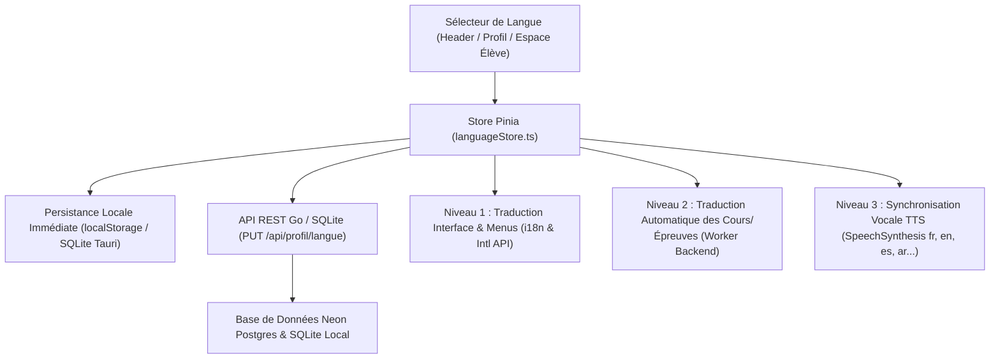

# Plan d'Implémentation : API Native des Langues, Système Multilingue & Traduction Automatique des Contenus

Ce document décrit l'architecture complète, l'étude comparative des moteurs et les étapes de déploiement technique d'une **API native des langues** permettant à chaque utilisateur (élève, moniteur, secrétaire, directeur) de sélectionner sa langue préférée, de l'enregistrer durablement en base de données, et de **traduire automatiquement les cours et épreuves déposés en français par la secrétaire**, tout en synchronisant la synthèse vocale.

---

## 1. Vision & Architecture Globale

Le système multilingue combine trois niveaux complémentaires :



### Bénéfices majeurs :
1. **Pérennité & Multi-appareils :** La langue choisie est sauvegardée dans le profil utilisateur en base de données et restaurée sur tous ses supports.
2. **Fonctionnement Hors-Ligne :** Les traductions des cours et des épreuves sont pré-enregistrées en base, permettant une lecture et une écoute 100% hors-ligne.
3. **Zéro charge pour le secrétariat :** La secrétaire continue de saisir ses cours et épreuves normalement en français ; le système gère les traductions en arrière-plan sans intervention humaine.

---

## 2. Étude Comparative des 3 Moteurs & Recommandation d'Ingénierie

### A. Tableau Comparatif des Solutions

| Critère d'Évaluation | 🥇 **Option A : DeepL API (Gratuit)** | 🥈 **Option B : LibreTranslate (Open-Source)** | 🥉 **Option C : Chromium Native (`window.ai`)** |
|---|---|---|---|
| **Qualité & Précision du vocabulaire routier** | ⭐️⭐️⭐️⭐️⭐️ **N°1 Mondial absolu**<br>Traduction parfaite des nuances juridiques (*cédez-le-passage*, *rabattement*, *voie d'insertion*). | ⭐️⭐️⭐️ **Bonne à moyenne**<br>Moteur Argos/OpenNMT. Parfois trop littéral ou rigide sur les termes spécifiques du permis. | ⭐️⭐️⭐️⭐️ **Très bonne**<br>Propulsé par le modèle local Gemini Nano, mais sujet aux variations de version du navigateur. |
| **Fonctionnement Hors-Ligne pour l'élève** | 🟢 **100% Hors-ligne** *(car la traduction est générée à l'upload et stockée définitivement en base de données)*. | 🟢 **100% Hors-ligne** *(si installé sur le serveur local de l'auto-école)*. | 🟢 **100% Hors-ligne natif** *(exécuté directement sur le processeur/GPU de la machine)*. |
| **Stabilité & Disponibilité technique** | 🟢 **Excellente (Production Ready)**<br>API REST standard officielle, mature et éprouvée mondialement. | 🟢 **Très stable**<br>Totalement souverain, aucune dépendance externe. | ⚠️ **Encore expérimental (Early Preview)**<br>Nécessite des drapeaux d'activation spécifiques sur Chrome/Edge ; intégration incertaine sur certains OS anciens. |
| **Coût & Limites** | **0 FCFA**<br>Formule gratuite à vie : **500 000 caractères / mois** gratuits (~150 cours ou épreuves/mois). | **0 FCFA (Illimité)**<br>Aucun quota, mais nécessite ~1,5 Go de mémoire RAM sur le serveur hôte. | **0 FCFA (Illimité)**<br>Aucun coût de serveur, mais utilise la RAM et la batterie de l'ordinateur/smartphone élève. |
| **Complexité d'intégration** | 🟢 **Très simple**<br>Un simple appel HTTP `POST` en Go avec une clé API gratuite. | 🟡 **Moyenne**<br>Nécessite d'installer et maintenir un conteneur Docker LibreTranslate sur le serveur. | 🟡 **Complexe**<br>Détection obligatoire du support navigateur avec code de repli lourd. |

---

### B. Recommandation Justifiée : DeepL API Gratuite en Priorité N°1

Notre recommandation technique s'appuie sur quatre raisons indiscutables :

1. **La sécurité juridique du Code de la Route (Zéro contresens) :**
   Dans le domaine du permis de conduire, une erreur de traduction peut induire un élève en erreur grave (ex: confondre *« priorité à droite »* et *« cédez le passage »*). DeepL est réputé pour être le moteur le plus précis au monde sur les contextes réglementaires et techniques.
2. **Le quota gratuit de 500 000 caractères est largement suffisant et inépuisable :**
   - Une fiche de cours ou une épreuve fait en moyenne entre 2 500 et 4 000 caractères.
   - Avec 500 000 caractères gratuits chaque mois, vous pouvez traduire **120 à 150 nouveaux cours ou épreuves par mois**.
   - **Règle d'or de notre architecture :** Comme notre système enregistre définitivement la traduction dans la base de données (colonne `traductions JSONB`), **un cours n'est traduit qu'une seule et unique fois**. Le mois suivant, votre quota de 500 000 caractères est intact à 100% pour les nouveaux contenus !
3. **Garantie d'un fonctionnement 100% Hors-Ligne pour l'élève :**
   La traduction étant pré-enregistrée en base de données lors du téléversement par la secrétaire, l'élève peut réviser et écouter ses cours en anglais ou en arabe **sans aucune connexion internet**, que ce soit sur Desktop Tauri ou sur mobile PWA.
4. **Préservation des performances des appareils élèves :**
   L'élève n'a pas besoin d'un ordinateur surpuissant ou d'un smartphone dernier cri pour exécuter un modèle d'IA local : le texte arrive déjà traduit et léger.

---

### C. Architecture Modulaire : Le Pattern `TranslationProvider` (Zéro Verrouillage)

Pour garantir une indépendance absolue, le backend Go est conçu avec une **interface abstraite interchangeable** :

```go
// Interface universelle dans backend/internal/service/translation_service.go
type TranslationProvider interface {
    Translate(ctx context.Context, text string, sourceLang, targetLang string) (string, error)
}
```

- **Fournisseur actif par défaut :** `DeepLProvider` (clé API gratuite configurée dans l'environnement).
- **Fournisseur de repli ou alternatif :** `LibreTranslateProvider` ou `ChromiumNativeProvider`.
- Si un jour l'auto-école souhaite basculer sur un moteur 100% auto-hébergé, il suffit de changer une seule variable d'environnement (`TRANSLATION_PROVIDER=libretranslate`) sans toucher au code de l'application !

---

## 3. Traduction Automatique des Contenus Déposés en Français

### A. Le Cas d'Usage
> *Une secrétaire téléverse un cours ou une épreuve rédigée exclusivement en français. Un élève anglophone ou arabophone consulte le document.*

### B. Le Mécanisme de Pré-Traduction en Arrière-Plan


### C. Fonctionnement Détaillé :
1. **Détection automatique :** Lors de l'enregistrement d'un support de cours ou d'une épreuve, le backend vérifie si des versions multilingues ont été fournies manuellement.
2. **Traduction automatique asynchrone :** Si seule la version française existe, le worker déclenche la traduction du titre, de la description et du texte du cours vers les langues actives du système (anglais, espagnol, arabe).
3. **Stockage structuré :** Les traductions sont stockées directement dans la table concernée via une colonne `traductions JSONB`.
4. **Contrôle & Ajustement :** La direction ou un moniteur peut à tout moment modifier ou affiner la traduction générée s'il le désire.

---

## 4. Expérience Utilisateur (UX) pour l'Élève

### A. Affichage Intelligent du Contenu
- Si l'élève a configuré son profil en **Anglais** :
  - Le système charge en priorité la traduction anglaise pré-calculée.
  - Un badge discret et rassurant s'affiche sous le titre du cours :
    > 🌐 *« Traduit automatiquement du français » · [Voir la version originale (FR)]*
- Un bouton à bascule permet à l'élève de basculer en un clic entre la **version traduite** et la **version originale française** pour comparer les termes officiels.

### B. Lecture Audio (TTS) Adaptée
- Dès que l'élève clique sur `[🔊 Écouter le cours]` ou lance un `Quiz Audio` :
  - Le système lit le texte traduit en utilisant la **voix native du système d'exploitation correspondant à sa langue** (`en-US`, `es-ES`, etc.).
  - Le débit et la prononciation sont naturels et parfaitement compréhensibles.

### C. Repli Gracieux (Fallback) sur les Documents Non Traduisibles
- Si le fichier est un PDF scanné sous forme d'image pure (sans texte vectoriel) :
  - Le système affiche la version originale française sans jamais bloquer l'interface.
  - Une notice claire informe l'élève : *« Ce document est une copie numérisée en français. La traduction automatique n'est pas disponible pour cette fiche. »*

---

## 5. Évolution de la Base de Données

### A. Préférence de Langue Utilisateur & Candidat
```sql
-- Ajout de la langue préférée sur les comptes
ALTER TABLE utilisateurs 
ADD COLUMN IF NOT EXISTS langue_preferee VARCHAR(10) DEFAULT 'fr';

ALTER TABLE candidats 
ADD COLUMN IF NOT EXISTS langue_preferee VARCHAR(10) DEFAULT 'fr';
```

### B. Table des Langues Systèmes Actives
```sql
CREATE TABLE IF NOT EXISTS langues_systeme (
    code VARCHAR(10) PRIMARY KEY, -- 'fr', 'en', 'es', 'ar'
    nom_natif VARCHAR(50) NOT NULL,
    drapeau_emoji VARCHAR(10) NOT NULL,
    code_locale_tts VARCHAR(15) NOT NULL,
    direction VARCHAR(3) DEFAULT 'ltr',
    est_active BOOLEAN DEFAULT TRUE,
    ordre_affichage INT DEFAULT 0
);

INSERT INTO langues_systeme (code, nom_natif, drapeau_emoji, code_locale_tts, direction, est_active, ordre_affichage)
VALUES 
    ('fr', 'Français', '🇫🇷', 'fr-FR', 'ltr', TRUE, 1),
    ('en', 'English', '🇬🇧', 'en-US', 'ltr', TRUE, 2),
    ('es', 'Español', '🇪🇸', 'es-ES', 'ltr', TRUE, 3),
    ('ar', 'العربية', '🇸🇦', 'ar-SA', 'rtl', TRUE, 4)
ON CONFLICT (code) DO NOTHING;
```

### C. Colonne de Traduction sur les Cours et Épreuves
```sql
-- Stockage des traductions générées en JSONB
ALTER TABLE supports_cours 
ADD COLUMN IF NOT EXISTS traductions JSONB DEFAULT '{}'::jsonb;

ALTER TABLE epreuves_examens 
ADD COLUMN IF NOT EXISTS traductions JSONB DEFAULT '{}'::jsonb;
```

*Exemple de contenu dans la colonne `traductions` :*
```json
{
  "en": {
    "titre": "Right of Way Rules at Intersections",
    "description": "Comprehensive guide on priority signs and roundabouts.",
    "contenu_texte": "At an uncontrolled intersection, vehicles approaching from the right have priority..."
  },
  "es": {
    "titre": "Reglas de Prioridad en Intersecciones",
    "description": "Guía completa sobre señales de prioridad y rotondas.",
    "contenu_texte": "En una intersección sin señalización, los vehículos que vienen por la derecha tienen prioridad..."
  }
}
```

---

## 6. Endpoints Backend & Services

1. **`GET /api/langues` :** Liste les langues actives avec métadonnées et voix TTS recommandées.
2. **`PUT /api/profil/langue` :** Enregistre la langue choisie par l'utilisateur connecté dans Postgres et le profil de session.
3. **`POST /api/traductions/cours/:id` :** Déclenche la génération ou l'actualisation manuelle de la traduction d'un cours.
4. **Service de Traduction Go (`backend/internal/service/translation_service.go`) :**
   - Connecteur abstrait `TranslationProvider` implémentant le client DeepL API Free (avec fallback LibreTranslate possible).
   - Mode asynchrone via goroutine (aucun temps d'attente pour la secrétaire lors de l'enregistrement).

---

## 7. Architecture Frontend (Vue 3 / TypeScript)

1. **Store Pinia (`src/stores/languageStore.ts`) :**
   - Gère la langue active, synchronise le `localStorage` et effectue l'appel API `api.updateUserLanguage(langue)`.
2. **Service i18n (`src/services/i18nService.ts`) :**
   - Fournit la fonction de traduction réactive `t('cle.message')` pour l'interface utilisateur.
3. **Helper de Contenu Multilingue (`src/utils/multilingualHelper.ts`) :**
   - Fonction `getLocalizedContent(item, langueCode)` :
     - Si la traduction existe dans `item.traductions[langueCode]`, retourne la version traduite.
     - Sinon, retourne la version originale française (fallback propre).
4. **Composant UI `ContentLanguageToggle.vue` :**
   - Affiche le badge « Traduit automatiquement » et le bouton pour basculer vers l'original.

---

## 8. Feuille de Route d'Implémentation Étape par Étape

| Étape | Intitulé | Tâches principales |
|:---:|---|---|
| **1** | **Base de Données** | Migration SQL : ajout de `langue_preferee` sur `utilisateurs`/`candidats`, table `langues_systeme`, et colonne `traductions JSONB` sur `supports_cours` et `epreuves_examens`. |
| **2** | **Backend Langues & Profil** | Endpoints `GET /api/langues` et `PUT /api/profil/langue`, commande Rust SQLite pour l'app Desktop. |
| **3** | **Worker de Traduction Asynchrone (DeepL)** | Création du `translation_service.go` avec goroutine d'arrière-plan et connecteur DeepL API Free (500k car./mois). |
| **4** | **Service i18n & Store Frontend** | Mise en place de `i18nService.ts`, `languageStore.ts` et dictionnaires de base (`fr.json`, `en.json`). |
| **5** | **Composants d'Interface** | Sélecteur de langue dans `TauriDesktopHeader.vue`, `UserProfileAndSchoolModal.vue` et `CandidatPwaView.vue`. |
| **6** | **Affichage & Lecture Audio Multilingue** | Intégration du composant de bascule Original/Traduit dans les cours/épreuves et synchronisation de la voix TTS. |

---

## 9. Synthèse Finale

Cette architecture répond fidèlement à tous vos critères :
- **Secrétaire :** Travaille 100% en français sans aucune charge additionnelle.
- **Élève :** Lit et écoute son cours dans sa langue préférée (anglais, espagnol, arabe, etc.).
- **Application :** Fonctionne à 100% hors-ligne grâce aux traductions pré-stockées en base de données.
- **Coût & Fiabilité :** **0 FCFA** et **zéro contresens juridique** grâce à l'excellence de DeepL Free couplée à notre cache de base de données.
