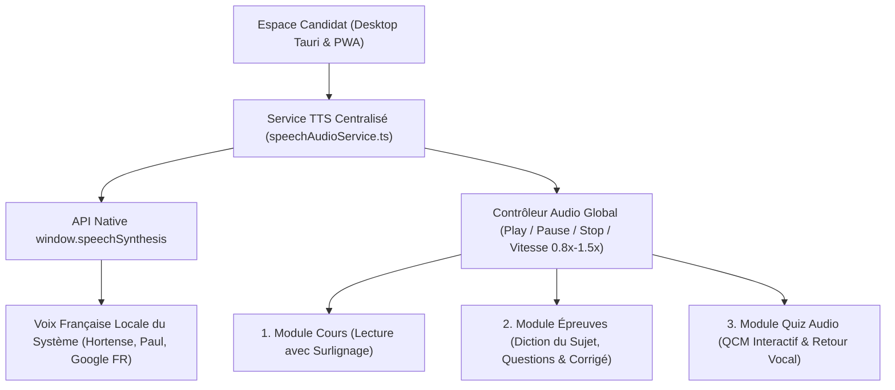

# Plan d'Implémentation : Synthèse Vocale Locale (TTS) pour Cours, Épreuves & Quiz Audio

Ce document définit la feuille de route technique complète pour déployer une **synthèse vocale locale (TTS)** 100% hors-ligne, sans dépendance externe ni coût serveur, couvrant les **cours**, les **épreuves** et les **quiz audio interactifs**.

---

## 1. Périmètre & Fonctionnalités Clés

Le système repose sur un moteur unique et universel : **l'API native Web Speech (SpeechSynthesis)** intégrée dans les navigateurs et le runtime desktop Tauri.

### Les 3 piliers couverts :
1. **Lecture audio des Cours :** Fiches théoriques, règles de circulation, panneaux de signalisation avec surlignage visuel synchronisé (karaoké pédagogique).
2. **Lecture audio des Épreuves :** Lecture vocale complète du sujet d'épreuve, des consignes ministérielles, des exercices/questions et du corrigé officiel dans le visualiseur d'épreuves.
3. **Module de Quiz Audio interactif :** Entraînement interactif avec diction de chaque question, des options A/B/C/D et verdict vocal immédiat avec explication.

---

## 2. Architecture Technique (100% Hors-Ligne & Zéro Coût)

### Avantages majeurs :
- **100% Déconnecté :** Fonctionne partout, même sans aucune connexion internet.
- **Instantané & Léger :** Zéro mégaoctet de fichier audio à héberger ou télécharger ; la synthèse vocale lit directement le texte de l'application.
- **Protection des contenus :** Pas de fichiers MP3 bruts téléchargeables sur disque.

---

## 3. Expérience Utilisateur (UX) par Module

### A. Lecture Vocale des Supports de Cours
- **Déclenchement :** Bouton `[🔊 Écouter le cours]` dans chaque support de cours.
- **Barre audio en bas d'écran :**
  - Boutons Play / Pause / Stop / Saut de paragraphe (précédent/suivant).
  - Vitesse de diction : `0.8x` (lent), `1.0x` (normal), `1.25x` (rapide).
- **Surlignage en temps réel :** Le paragraphe ou la règle en cours d'énoncé est surligné pour faciliter le suivi visuel.

### B. Lecture Vocale des Épreuves (`EpreuveViewerModal.vue`)
- **Déclenchement :** Bouton `[🔊 Lecture Audio de l'épreuve]` dans la barre d'action de l'épreuve.
- **Modes de lecture disponibles pour l'élève :**
  - **Lecture complète de l'épreuve :** Lit le titre, le contexte, les consignes et les questions dans l'ordre.
  - **Lecture ciblée par question :** Chaque question ou exercice dispose d'un bouton d'écoute individuelle `[🔊 Écouter cette question]`.
  - **Lecture du corrigé :** Si le corrigé est débloqué, la voix lit les explications et justifications de chaque réponse.

### C. Module de Quiz Audio Interactif
- **Déroulement d'une question :**
  1. La voix lit l'intitulé : *« Question 4 : À cette intersection, quel usager doit céder le passage ? »*
  2. La voix énonce les options :
     - *« Option A : Le véhicule bleu »*
     - *« Option B : Mon véhicule »*
  3. L'élève clique sur son choix.
  4. Réaction vocale instantanée : *« Bonne réponse ! »* ou *« Incorrect. Règle : La priorité à droite s'applique en l'absence de panneau. »*
- Bouton pour réécouter la question ou l'explication à tout moment.

---

## 4. Feuille de Route d'Implémentation Étape par Étape

### Étape 1 : Moteur Vocal Singleton (`src/services/speechAudioService.ts`)
- Détection et sélection automatique de la voix française la plus qualitative sur la machine.
- Contrôles standards : `lire(texte, options)`, `pause()`, `reprendre()`, `arreter()`, `setVitesse(rate)`.
- Événements de synchronisation pour le surlignage (`onboundary`, `onend`).

### Étape 2 : Barre de Contrôle Audio Flottante (`src/components/common/AudioSpeechBar.vue`)
- Barre ergonomique rétractable positionnée en bas d'écran.
- Indicateur visuel d'ondes sonores en cours d'élocution.
- Contrôles de lecture (Play/Pause/Stop, Vitesse, progression).

### Étape 3 : Intégration dans les Cours (`CandidatSupportsCoursView.vue`)
- Extraction / découpage du texte des fiches de cours en blocs audibles.
- Déclenchement de la lecture et surlignage synchronisé.

### Étape 4 : Intégration dans le Visualiseur d'Épreuves (`EpreuveViewerModal.vue`)
- Ajout du bouton d'écoute globale de l'épreuve dans la modale.
- Boutons d'écoute ciblée par question/énoncé.
- Lecture audio de la grille de correction et des explications.

### Étape 5 : Module de Quiz Audio Interactif
- Enchaînement automatique question -> options -> écoute de la réponse de l'élève -> verdict vocal.
- Option activable/désactivable d'un clic pour laisser l'élève choisir son mode d'entraînement.

---

## 5. Synthèse & Validation

Ce plan répond fidèlement à l'ensemble de vos exigences :
- **Moteur unique : TTS local 100% hors-ligne.**
- **Supports de cours + Épreuves officielles/annales + Quiz interactifs.**
- **Zéro surcoût et zéro dépendance externe.**
