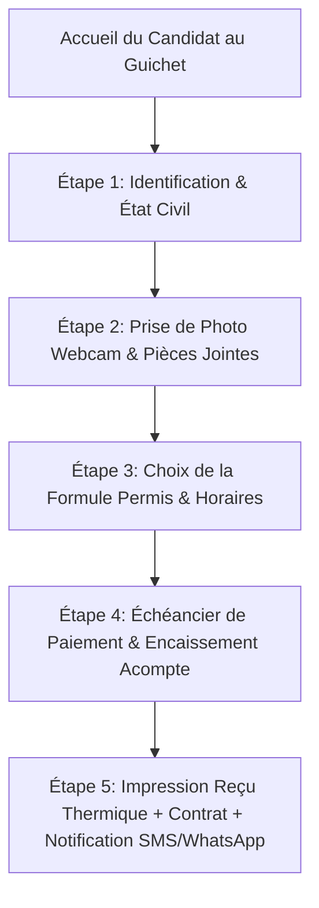
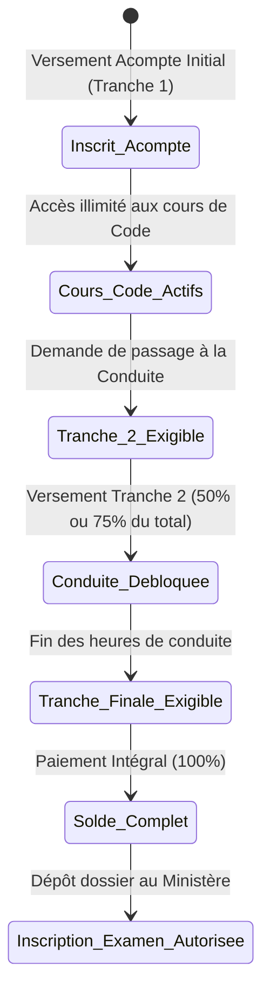
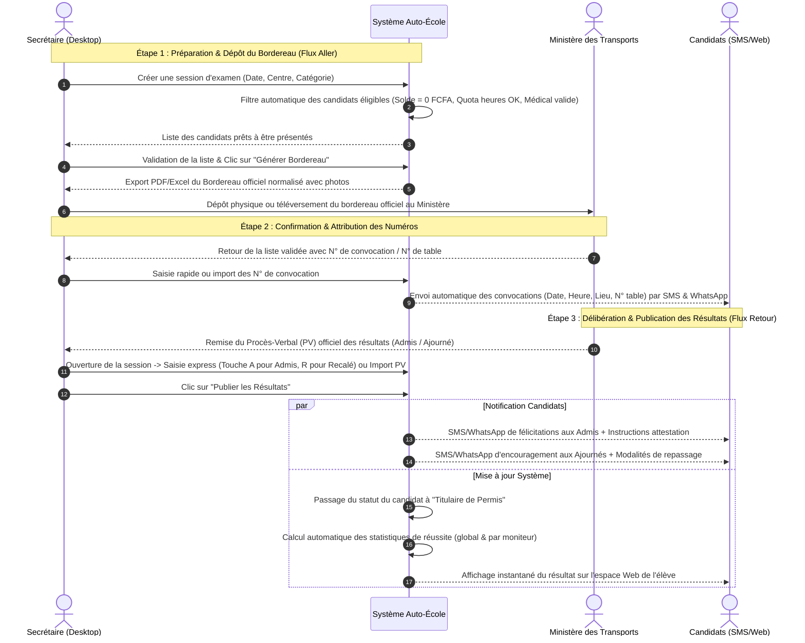

# Spécifications Fonctionnelles Détaillées
## Logiciel Hybride de Gestion d'Auto-École

---

## 1. Parcours Complet d'une Inscription au Guichet (Interface Desktop)

Le parcours d'inscription au guichet est conçu pour être exécuté en **moins de 3 minutes** par la secrétaire, avec ou sans connexion Internet, grâce à une ergonomie optimisée au clavier.

### 1.1. Formulaire d'Enrôlement : Champs & Règles de Gestion

#### Bloc A : Identité & Contact du Candidat
* **Nom & Prénoms** *(Obligatoire)* : Nom de famille et prénoms complets selon la pièce d'identité.
* **Genre / Sexe** *(Obligatoire)* : M / F.
* **Date & Lieu de Naissance** *(Obligatoire)* : Vérification automatique de l'âge légal (ex: minimum 18 ans pour le Permis B, 16 ans pour Permis A1).
* **Nationalité** *(Obligatoire)* : Par défaut le pays local, avec sélection rapide.
* **Profession & Niveau d'études** *(Optionnel)* : Utile pour le ciblage pédagogique.
* **Adresse / Quartier de résidence** *(Obligatoire)* : Ville, Commune, Quartier, Repère géographique.
* **Numéro WhatsApp Principal** *(Obligatoire)* : Sert d'identifiant de connexion et de canal prioritaire d'alertes.
* **Numéro Téléphonique d'Urgence / Tuteur** *(Recommandé)* : Contact d'un proche en cas d'accident ou pour les mineurs.
* **Groupe Sanguin & Antécédents Médicaux** *(Optionnel / Recommandé)* : A+, O+, port de lunettes obligatoires, etc.

#### Bloc B : Capture Photo & Numérisation des Pièces
* **Prise de vue Webcam 1-Clic** :
  - Intégration directe de la webcam du PC ou d'une caméra USB de bureau.
  - Détection automatique des visages avec cadrage type photo d'identité (format 4x4 officiel).
  - Recadrage instantané sans outil externe.
* **Pièces d'Identité & Dossier Médical** :
  - *Type de pièce* : CNI, Passeport, Attestation d'Identité, Carte Consulaire.
  - *Numéro de pièce et date de validité*.
  - *Visite médicale* : Date du certificat médical, nom du médecin/centre agréé, aptitude (Apte sans réserve / Apte avec verres correcteurs).
  - *Numérisation / Dépôt* : Capture par scanner USB ou glisser-déposer de fichiers images/PDF. Possibilité d'inscription avec **"Pièce en attente"** (avec blocage avant présentation à l'examen).

#### Bloc C : Choix de la Formation & Contrat
* **Catégorie de Permis** : Permis A (Moto), B (Véhicule léger), C (Poids lourd), D (Transport en commun), E (Remorque), Recyclage / Perfectionnement.
* **Formule Pédagogique** :
  - *Formule Standard* (cours réguliers en journée).
  - *Formule Accélérée / VIP* (priorité sur les plannings, cours intensifs).
  - *Formule Cours du Soir / Weekend*.
* **Contenu du Forfait** :
  - Quota d'heures théoriques (Code) incluses (ex: 20h ou illimité jusqu'à obtention).
  - Quota d'heures pratiques (Conduite) incluses (ex: 15h, 20h, 25h).
  - Frais de dossier, livret d'apprentissage, et 1ère présentation à l'examen d'État inclus.
* **Génération Automatique du Numéro de Dossier Unique** :
  - Format normalisé : `[CODE_AGENCE]-[ANNEE]-[CATEGORIE]-[NUMERO_INCREMENTAL]`  
    *Exemple : `REF-2026-B-0042`*.

---

## 2. Système de Caisse & Gestion des Tranches de Paiement

Le modèle financier des auto-écoles en Afrique repose quasi exclusivement sur le **paiement échelonné par tranches (acomptes)**. Le logiciel doit garantir une rigueur comptable absolue.

### 2.1. Règles Métier & Verrous Pédagogiques Paramétrables

Pour éviter les impayés sans bloquer arbitrairement les élèves, le logiciel intègre des **verrous automatiques paramétrables par le Directeur** :

1. **Règle Acompte Minimum à l'Inscription** :
   - Un montant minimum d'acompte (ex: 30% ou montant fixe 40 000 FCFA) est obligatoire pour valider la création du dossier et remettre le livret de code.
2. **Verrou Conduite Pratique (Tranche 2)** :
   - L'élève ne peut réserver ses heures de conduite sur l'application que s'il a atteint au moins 60% du paiement total.
   - Si le seuil n'est pas atteint, l'interface du moniteur et de la secrétaire affiche un avertissement orangé : *"Solde insuffisant pour conduite (Reste 30 000 FCFA à régler)"*, avec possibilité d'accorder une dérogation exceptionnelle par code manager.
3. **Verrou Examen d'État (Solde 100% Obligatoire)** :
   - Le système **interdit formellement** l'ajout d'un candidat sur le bordereau officiel d'examen si son solde n'est pas à 0 FCFA.

### 2.2. Modes d'Encaissement & Émission des Reçus

* **Modes de Règlement Supportés** :
  - **Espèces (Cash)** : Avec calcul automatique du rendu de monnaie dans l'interface guichet.
  - **Mobile Money Direct Guichet** : La secrétaire saisit la référence de transaction SMS (Orange Money, Wave, MTN MoMo, Moov).
  - **Paiement Mobile Money en Ligne (Apprenant)** : Crédité directement sur le compte avec rapprochement instantané.
  - **Chèques / Virements** (dossiers entreprises / flottes).
* **Spécifications du Reçu de Caisse Infalsifiable** :
  - Format : Ticket thermique (80mm ou 58mm ESC/POS) + option A5/A4 PDF.
  - Mentions obligatoires imprimées :
    - En-tête auto-école (Nom, N° Agrément ministériel, Contacts, Adresse).
    - N° de Reçu séquentiel immuable (ex: `REC-2026-00389`).
    - Date et heure exacte de l'encaissement.
    - Nom de l'élève & N° de dossier.
    - Montant versé ce jour (en chiffres et lettres).
    - Mode de règlement et référence éventuelle.
    - **Total Forfait | Cumul Déjà Payé | Reste à Payer (Solde)**.
    - Nom/Prénom de la secrétaire/caissière connectée.
    - **QR Code sécurisé d'authenticité** (permet de vérifier en 1 seconde l'authenticité du ticket en cas de litige).

### 2.3. Gestion & Clôture de Caisse Quotidienne (Point de Caisse)

Chaque jour, à la fin du service de la secrétaire :
* Génération du **Rapport de Caisse Journalier (Z de Caisse)** :
  - Total Espèces encaissées physiquement dans le tiroir-caisse.
  - Total Mobile Money reçu.
  - Nombre total de transactions.
  - Liste nominative des paiements de la journée.
* Saisie du comptage physique des billets/pièces pour détecter tout écart de caisse (surplus ou déficit).
* Validation et verrouillage de la caisse avec envoi automatique d'un récapitulatif WhatsApp/Email au Directeur.

---

## 3. Matrice Exhaustive des Fonctionnalités par Rôle & Plateforme

Voici la cartographie complète de toutes les fonctionnalités requises, réparties entre l'application **Desktop** et l'application **Web / Mobile (PWA)** :

| Module | Fonctionnalité | Desktop (Guichet / Manager) | Web / Mobile (Moniteur) | Web / Mobile (Élève) |
| :--- | :--- | :---: | :---: | :---: |
| **1. Inscriptions & Dossiers** | Formulaire d'enrôlement rapide guichet | ✅ (Complet) | ❌ | ❌ |
| | Pré-inscription en ligne | ❌ | ❌ | ✅ |
| | Capture photo webcam & pièces d'identité | ✅ (Direct) | ❌ | ✅ (Upload) |
| | Gestion des dossiers médicaux & validité | ✅ | ❌ | 👁️ (Lecture) |
| | Archivage et historique des candidatures | ✅ | ❌ | ❌ |
| **2. Caisse & Recouvrement** | Encaissement tranches (Cash & Mobile Money) | ✅ | ❌ | ❌ |
| | Paiement en ligne (Passerelle Wave/MoMo) | ❌ | ❌ | ✅ |
| | Impression directe tickets thermiques & reçus A4 | ✅ | ❌ | 👁️ (Téléchargement) |
| | Point de caisse journalier & clôture Z | ✅ | ❌ | ❌ |
| | Échéancier de paiement & calcul solde | ✅ | 👁️ (Alerte visuelle) | ✅ (Transparence solde) |
| | Alertes automatiques relances impayés (SMS/WA)| ✅ (Auto/Manuel) | ❌ | ❌ |
| **3. Code de la Route (Théorie)**| Pointage des présences en salle de code | ✅ (1-clic ou badge) | ❌ | 👁️ (Historique) |
| | Séries de tests & Quiz de code en ligne | ❌ | ❌ | ✅ (Entraînement 24/7) |
| | Suivi des scores et statistiques de réussite | ✅ | 👁️ (Suivi élève) | ✅ |
| | Déblocage attestation d'assiduité au code | ✅ | ❌ | ❌ |
| **4. Conduite Pratique** | Prise de rendez-vous / Planning de conduite | ✅ (Vue globale) | 👁️ (Planning perso) | ✅ (Réservation créneau) |
| | Fiche de suivi de conduite numérique | 👁️ (Audit) | ✅ (Notation compétences)| 👁️ (Compte-rendu) |
| | Validation fin de séance (Signature élève/moniteur)| ❌ | ✅ (Sur écran tactile) | ✅ (Validation séance) |
| | Décompte automatique du forfait d'heures | ✅ | ✅ | ✅ |
| **5. Flotte Automobile** | Fiche véhicule (Immatriculation, type, carburant)| ✅ | 👁️ (Affectation) | ❌ |
| | Carnet d'entretien (Vidange, plaquettes, etc.) | ✅ | ❌ | ❌ |
| | Alertes expiration Visite Technique & Assurance | ✅ (Bannières d'alerte)| ❌ | ❌ |
| | Relevé kilométrique départ/retour | 👁️ (Suivi) | ✅ (Saisie journalière)| ❌ |
| **6. Examens d'État** | Création des sessions officielles d'examen | ✅ | ❌ | ❌ |
| | Génération du bordereau officiel (Ministère) | ✅ (Export PDF/Excel) | ❌ | ❌ |
| | Convocation automatique des élèves (SMS/WA) | ✅ | ❌ | ✅ (Reçue sur mobile) |
| | Saisie des résultats officiels (Admis/Ajourné)| ✅ | 👁️ (Résultats) | ✅ (Notification admis) |
| **7. Pilotage & Décision** | Tableau de bord CA, inscriptions, impayés | ✅ (Temps réel) | ❌ | ❌ |
| | Taux de réussite aux examens par moniteur | ✅ | ❌ | ❌ |
| | Audit log (Historique des modifications sensibles)| ✅ (Gérant seul) | ❌ | ❌ |
| **8. Résilience & Système** | Mode Hors-Ligne total (Offline-First) | ✅ (Natif) | ⚠️ (Cache PWA) | ⚠️ (Cache PWA) |
| | Synchronisation automatique dès retour réseau | ✅ | ✅ | ✅ |
| | Sauvegarde locale automatique (Clé USB / Disque)| ✅ | ❌ | ❌ |

---

## 4. Workflow Détaillé des Examens d'État

Le cycle d'examen officiel se divise en deux étapes majeures : **la préparation du bordereau de présentation (Flux Aller)** et **la publication des résultats (Flux Retour)**.

### 4.1. Qui génère le Bordereau Ministériel ? (Flux Aller)
1. **C'est le LOGICIEL qui génère le bordereau** :
   - La secrétaire ne perd plus des heures sur Excel ou Word.
   - En créant la session d'examen (ex: *"Session du 25 Novembre 2026 - Centre de Treichville"*), le système filtre automatiquement les élèves :
     - ✅ Solde de caisse = 0 FCFA (aucun impayé).
     - ✅ Quota légal d'heures théoriques et pratiques atteint.
     - ✅ Certificat médical à jour (non expiré).
   - En 1 clic, le logiciel génère le **Bordereau Officiel au format exact exigé par le Ministère des Transports** (avec logo républicain, photos d'identité des élèves, numéros CNI, groupe sanguin et catégories).
2. **Prise en compte du retour du Ministère** :
   - Lorsque le Ministère valide la liste et attribue les numéros officiels de table/convocation, la secrétaire les saisit rapidement dans la grille du logiciel.
   - Dès la validation, le logiciel expédie automatiquement les **convocations officielles par WhatsApp et SMS** à tous les candidats de la session.

### 4.2. Comment sont traités et publiés les Résultats ? (Flux Retour)
1. **Saisie Express par la Secrétaire** :
   - Dès réception du Procès-Verbal (PV) officiel du Ministère, la secrétaire ouvre la session concernée dans le logiciel Desktop.
   - Tous les candidats de la session sont déjà affichés à l'écran. La secrétaire utilise une saisie au clavier ultra-rapide :
     - Touche `A` = Admis
     - Touche `R` = Ajourné (avec choix : Échec Code ou Échec Conduite)
   - *Option import* : Si le ministère transmet un fichier Excel/CSV de délibération, un bouton "Importer le fichier des résultats" remplit automatiquement tous les statuts en 1 seconde.
2. **Déclenchement Automatique de la Publication** :
   - Dès que la secrétaire clique sur **"Publier & Diffuser les Résultats"** :
     - **Notifications individualisées WhatsApp / SMS** :
       - *Pour l'admis* : *"Félicitations [Nom] ! Vous êtes déclaré(e) ADMIS(E) au Permis B session du [Date]. Votre attestation provisoire sera disponible à l'agence le [Date]."*.
       - *Pour l'ajourné* : Message d'encouragement bienveillant avec le motif (Code ou Conduite) et la démarche pour s'inscrire à la prochaine session.
     - **Espace Web Apprenant** : L'espace personnel de l'élève s'illumine avec son statut officiel.
     - **Mise à jour du dossier** : Le dossier passe au statut *"Permis Obtenu"* ou *"En attente de repêchage"*.
     - **Mise à jour du tableau de bord de direction** : Le taux de réussite de l'auto-école, du moniteur et du véhicule utilisé est actualisé en temps réel.

